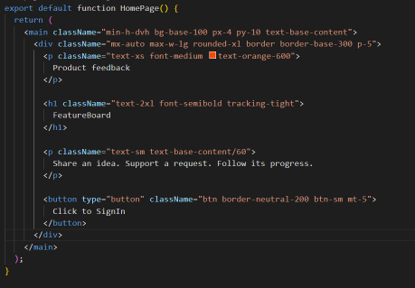

# Part 3 — Add DaisyUI and check the styling

We’ll use Tailwind CSS for layout and spacing, and DaisyUI for controls such as buttons, inputs, and dropdowns.

In the project terminal, install DaisyUI:

```bash
npm install -D daisyui@latest
```

## Configure the stylesheet

Open `app/globals.css` and replace its contents with:

```css
@import "tailwindcss";

@plugin "daisyui" {
  themes: light --default;
}
```

The import loads Tailwind CSS. The plugin enables DaisyUI and sets its light theme as the default.

DaisyUI includes the theme. We don’t need a separate theme package.

## Select the application theme

Open `app/layout.tsx`.

Keep the existing layout, font configuration, and import for `globals.css`.

Add `data-theme="light"` to the existing opening HTML tag:

```tsx
<html lang="en" data-theme="light">
```

The root layout wraps every page, so this selects the theme for the entire application.

## Create a styling checkpoint

Replace `app/page.tsx` with:

```tsx
export default function HomePage() {
  return (
    <main className="min-h-dvh bg-base-100 px-4 py-10 text-base-content">
      <div className="mx-auto max-w-lg rounded-xl border border-base-300 p-5">
        <p className="text-xs font-medium text-orange-600">
          Product feedback
        </p>

        <h1 className="text-2xl font-semibold tracking-tight">
          FeatureBoard
        </h1>

        <p className="text-sm text-base-content/60">
          Share an idea. Support a request. Follow its progress.
        </p>

        <button
          type="button"
          className="btn border-neutral-200 btn-sm mt-5"
        >
          Click to SignIn
        </button>
      </div>
    </main>
  );
}
```

The `base` colors come from the DaisyUI theme. They provide our background, text, and border colors.

The `btn` and `btn-sm` classes give the button its component styling and compact size.

The button doesn’t navigate yet. We’re checking its appearance before adding sign-in behavior.

Open the browser and confirm that the panel and button are styled.



## Checkpoint

DaisyUI is working. The page displays our light theme, bordered panel, and styled button.

Next, we’ll move the application header into a reusable component.