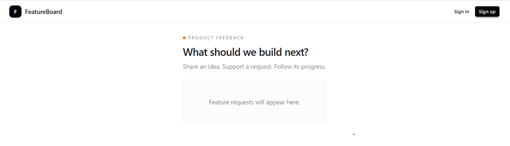

# Part 4 — Build the shared header

Our base styling works. Next, we’ll create the header that appears across the application.

A shared component keeps the branding and navigation consistent. When authentication is connected, we can update the account controls in one place.

## Create the header component

In the project root, create a `components` folder. Inside it, create a `layout` folder.

Create `components/layout/site-header.tsx`:

```tsx
import Link from "next/link";

export function SiteHeader() {
  return (
    <header className="border-b border-base-300">
      <div className="mx-auto flex min-h-12 max-w-6xl flex-wrap items-center justify-between gap-2 px-3 py-2 sm:px-4">
        <Link
          href="/"
          aria-label="FeatureBoard home"
          className="flex items-center gap-2"
        >
          <span
            aria-hidden="true"
            className="flex size-7 items-center justify-center rounded-lg bg-neutral text-xs font-bold text-neutral-content"
          >
            F
          </span>

          <span className="text-sm font-semibold">FeatureBoard</span>
        </Link>

        <nav
          aria-label="Account navigation"
          className="flex items-center gap-1"
        >
          <Link href="/sign-in" className="btn btn-ghost btn-xs">
            Sign in
          </Link>

          <Link href="/sign-up" className="btn btn-neutral btn-xs">
            Sign up
          </Link>
        </nav>
      </div>
    </header>
  );
}
```

We use Next.js `Link` for navigation between application pages.

The navigation label describes this group of links for assistive technology. The decorative letter is hidden from screen readers because the home link already has an accessible name.

This component doesn’t need state or browser events, so it doesn’t need `"use client"`.

## Add the header to the root layout

Open `app/layout.tsx`.

Add this import alongside the existing imports:

```tsx
import { SiteHeader } from "@/components/layout/site-header";
```

The `@/` alias points to our project root.

Add `className="h-full"` to the opening HTML tag. Keep the theme attribute:

```tsx
<html lang="en" data-theme="light" className="h-full">
```

Keep the existing font classes on the body. Add these classes to its existing `className`:

```text
h-full bg-base-100 text-base-content
```

Setting `h-full` on both elements lets the body fill the browser viewport height. Content can still extend the page and scroll when necessary.

Inside the existing `<body>`, place the header before `{children}`:

```tsx
<SiteHeader />
{children}
```

Keep the existing font configuration, metadata, and import for `globals.css`.

The header belongs in the root layout because every page in this version of the application shares it. Individual pages provide their own main content.

## Update the homepage

Replace `app/page.tsx` with:

```tsx
export default function HomePage() {
  return (
    <main className="mx-auto max-w-4xl px-3 py-5 sm:px-4 sm:py-7">
      <p className="flex items-center gap-1.5 text-[9px] font-semibold uppercase tracking-[0.18em] text-base-content/45">
        <span
          aria-hidden="true"
          className="size-1.5 rounded-full bg-orange-500"
        />
        Product feedback
      </p>

      <h1 className="mt-2 text-2xl font-semibold tracking-tight">
        What should we build next?
      </h1>

      <p className="mt-2 text-sm text-base-content/55">
        Share an idea. Support a request. Follow its progress.
      </p>

      <div className="mt-5 rounded-xl border border-dashed border-base-300 bg-base-200/30 px-4 py-10 text-center">
        <p className="text-sm text-base-content/55">
          Feature requests will appear here.
        </p>
      </div>
    </main>
  );
}
```

The homepage now contains only its own content. The root layout supplies the header and application background.

We’ll replace the placeholder with request cards in the next section.

## Check the result

Open the homepage in your browser.

Confirm that the header displays the logo, application name, and account links.

Resize the browser to check that the layout fits a narrow screen. Clicking the logo should return to the homepage.

The sign-in and sign-up links will show a not-found page until we create those routes.

<!-- Capture the browser showing the header, introduction, and placeholder.
Save the screenshot as images/04-shared-header.png. -->



## Save the checkpoint

We’re still working on the `feat/app-shell` branch.

Review the changed files:

```bash
git status --short
```

Stage the component, layout, homepage, and tutorial:

```bash
git add components/layout/site-header.tsx app/layout.tsx app/page.tsx docs/tutorial
```

Review the staged changes:

```bash
git diff --cached --stat
```

Commit and upload:

```bash
git commit -m "feat: add shared application header"
git push
```

## Checkpoint

Our application has a reusable header and a consistent page background. The code and documentation are saved on our feature branch.

Next, we’ll define the request data and build the first reusable request card.