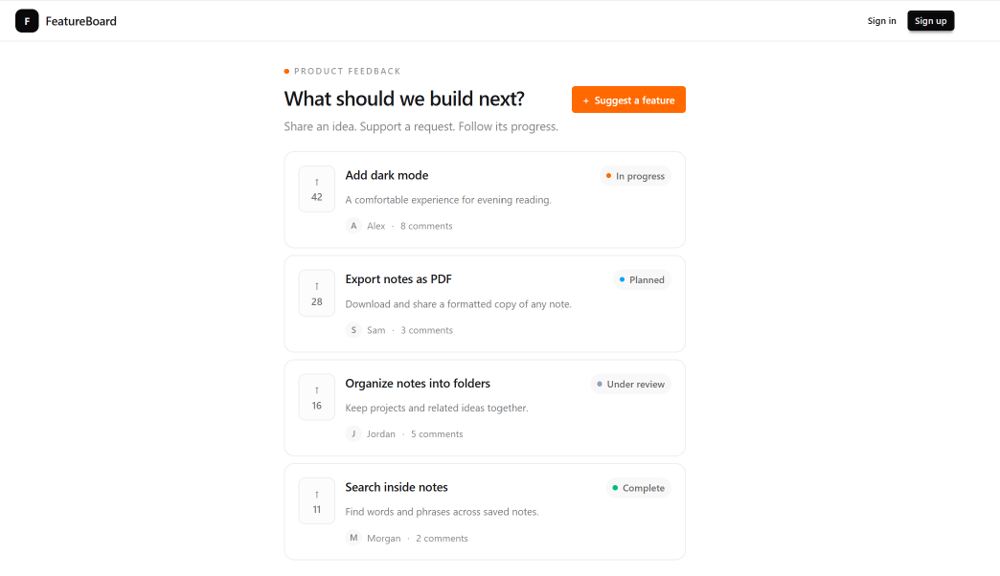

# Part 5 — Display feature requests

Our shared header is ready. Next, we’ll replace the homepage placeholder with feature requests.

We’ll separate the request type, sample data, and card component. This keeps the page focused on assembling the interface.

## Define the request type

Create a `features` folder in the project root. Inside it, create a `requests` folder.

Create `features/requests/types.ts`:

```ts
export type RequestStatus =
  | "UNDER_REVIEW"
  | "PLANNED"
  | "IN_PROGRESS"
  | "COMPLETE";

export type FeatureRequest = {
  id: string;
  title: string;
  description: string;
  author: {
    id: string;
    name: string;
  };
  votes: number;
  comments: number;
  status: RequestStatus;
};
```

The status type restricts requests to four valid values.

We use stable identifiers for the status values. The labels displayed to users will be defined separately.

The request type describes the data our interface needs. Later, we’ll map database results to this shape.

## Define the status labels

Create `features/requests/statuses.ts`:

```ts
import type { RequestStatus } from "./types";

export const requestStatuses: Record<
  RequestStatus,
  {
    label: string;
    dotClass: string;
  }
> = {
  UNDER_REVIEW: {
    label: "Under review",
    dotClass: "bg-slate-400",
  },
  PLANNED: {
    label: "Planned",
    dotClass: "bg-sky-500",
  },
  IN_PROGRESS: {
    label: "In progress",
    dotClass: "bg-orange-500",
  },
  COMPLETE: {
    label: "Complete",
    dotClass: "bg-emerald-500",
  },
};
```

This gives every status a consistent label and color.

The `Record` type requires an entry for each valid status. If we add another status later, TypeScript will flag the missing configuration.

## Add sample requests

Create `features/requests/mock-data.ts`:

```ts
import type { FeatureRequest } from "./types";

export const mockRequests: FeatureRequest[] = [
  {
    id: "1",
    title: "Add dark mode",
    description: "A comfortable experience for evening reading.",
    author: {
      id: "user-1",
      name: "Alex",
    },
    votes: 42,
    comments: 8,
    status: "IN_PROGRESS",
  },
  {
    id: "2",
    title: "Export notes as PDF",
    description: "Download and share a formatted copy of any note.",
    author: {
      id: "user-2",
      name: "Sam",
    },
    votes: 28,
    comments: 3,
    status: "PLANNED",
  },
  {
    id: "3",
    title: "Organize notes into folders",
    description: "Keep projects and related ideas together.",
    author: {
      id: "user-3",
      name: "Jordan",
    },
    votes: 16,
    comments: 5,
    status: "UNDER_REVIEW",
  },
  {
    id: "4",
    title: "Search inside notes",
    description: "Find words and phrases across saved notes.",
    author: {
      id: "user-4",
      name: "Morgan",
    },
    votes: 11,
    comments: 2,
    status: "COMPLETE",
  },
];
```

Sample data lets us build and inspect the interface before connecting PostgreSQL.

## Create the status badge

Inside `features/requests`, create a `components` folder.

Create `features/requests/components/request-status-badge.tsx`:

```tsx
import { requestStatuses } from "../statuses";
import type { RequestStatus } from "../types";

type RequestStatusBadgeProps = {
  status: RequestStatus;
};

export function RequestStatusBadge({
  status,
}: RequestStatusBadgeProps) {
  const configuration = requestStatuses[status];

  return (
    <span className="inline-flex shrink-0 items-center gap-1.5 rounded-full bg-base-200 px-2 py-1 text-[10px] font-medium text-base-content/65">
      <span
        aria-hidden="true"
        className={`size-1.5 rounded-full ${configuration.dotClass}`}
      />
      {configuration.label}
    </span>
  );
}
```

The badge includes a text label, so its meaning doesn’t depend on color.

We’ll reuse this component on the homepage, request details, and admin board.

## Create the request card

Create `features/requests/components/request-card.tsx`:

```tsx
import Link from "next/link";
import type { FeatureRequest } from "../types";
import { RequestStatusBadge } from "./request-status-badge";

type RequestCardProps = {
  request: FeatureRequest;
};

export function RequestCard({ request }: RequestCardProps) {
  return (
    <article className="flex min-w-0 items-start gap-3 rounded-xl border border-base-300 bg-base-100 p-3 sm:p-4">
      <div
        aria-label={`${request.votes} votes`}
        className="flex h-14 w-11 shrink-0 flex-col items-center justify-center gap-0.5 rounded-lg border border-base-300 bg-base-200/40 text-xs font-semibold text-base-content/60"
      >
        <span aria-hidden="true">↑</span>
        <span>{request.votes}</span>
      </div>

      <div className="min-w-0 flex-1">
        <div className="flex flex-col items-start justify-between gap-2 sm:flex-row sm:gap-3">
          <h2 className="break-words text-sm font-semibold leading-relaxed">
            <Link
              href={`/requests/${request.id}`}
              className="hover:underline"
            >
              {request.title}
            </Link>
          </h2>

          <RequestStatusBadge status={request.status} />
        </div>

        <p className="mt-1.5 break-words text-xs leading-relaxed text-base-content/60">
          {request.description}
        </p>

        <div className="mt-3 flex flex-wrap items-center gap-2 text-[10px] text-base-content/55">
          <span className="flex items-center gap-1.5">
            <span
              aria-hidden="true"
              className="flex size-5 items-center justify-center rounded-full bg-base-200 text-[9px] font-medium"
            >
              {request.author.name.charAt(0)}
            </span>

            {request.author.name}
          </span>

          <span aria-hidden="true">·</span>

          <Link
            href={`/requests/${request.id}#comments`}
            className="hover:underline"
          >
            {request.comments} comments
          </Link>
        </div>
      </div>
    </article>
  );
}
```

The card receives one request through its props. It doesn’t fetch data or manage the entire list.

The vote count is display-only for now. We’ll introduce a button when we implement voting.

## Display the cards on the homepage

Replace `app/page.tsx` with:

```tsx
import Link from "next/link";
import { RequestCard } from "@/features/requests/components/request-card";
import { mockRequests } from "@/features/requests/mock-data";

export default function HomePage() {
  return (
    <main className="mx-auto max-w-4xl px-3 py-5 sm:px-4 sm:py-7">
      <div className="flex flex-col justify-between gap-4 sm:flex-row sm:items-center">
        <div>
          <p className="flex items-center gap-1.5 text-[9px] font-semibold uppercase tracking-[0.18em] text-base-content/45">
            <span
              aria-hidden="true"
              className="size-1.5 rounded-full bg-orange-500"
            />
            Product feedback
          </p>

          <h1 className="mt-2 text-2xl font-semibold tracking-tight">
            What should we build next?
          </h1>

          <p className="mt-2 text-sm text-base-content/55">
            Share an idea. Support a request. Follow its progress.
          </p>
        </div>

        <Link
          href="/requests/new"
          className="btn btn-sm shrink-0 self-start border-orange-500 bg-orange-500 text-white shadow-none hover:border-orange-600 hover:bg-orange-600 sm:self-auto"
        >
          <span aria-hidden="true">+</span>
          Suggest a feature
        </Link>
      </div>

      <section
        aria-label="Feature requests"
        className="mt-5 space-y-2"
      >
        {mockRequests.map((request) => (
          <RequestCard key={request.id} request={request} />
        ))}
      </section>
    </main>
  );
}
```

The page assembles the introduction and request list.

Each card uses the request ID as its React key. This gives React a stable identity for each item.

These components don’t need browser state yet, so they remain Server Components.

## Check the result

Open the homepage.

Confirm that all four requests appear with their vote counts, authors, comment counts, and status badges.

Resize the browser. On narrow screens, the status badge should move below the title without creating horizontal overflow.

The request and submission links will work after we create their routes.

<!-- Capture the homepage with all four request cards.
Save the screenshot as images/05-request-cards.png. -->



## Save the checkpoint

Review the changes:

```bash
git status --short
```

Stage the request feature, homepage, and documentation:

```bash
git add features/requests app/page.tsx docs/tutorial
```

Review and commit:

```bash
git diff --cached --stat
git commit -m "feat: display typed feature request cards"
git push
```

## Checkpoint

Our homepage displays reusable request cards using typed sample data.

Next, we’ll add search, status filtering, and sorting.
