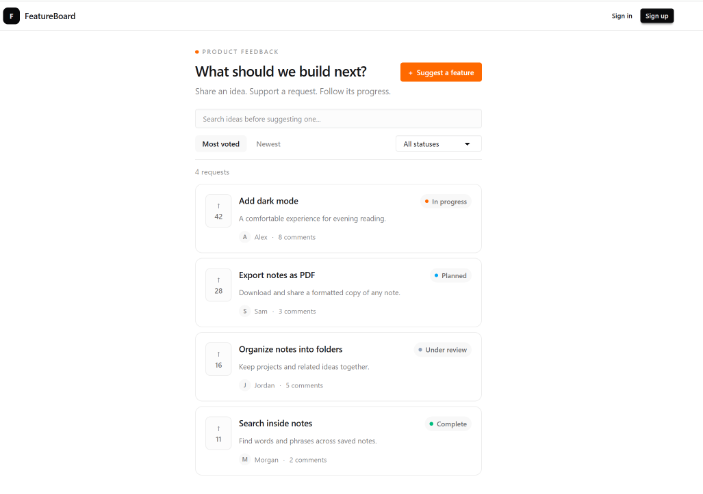
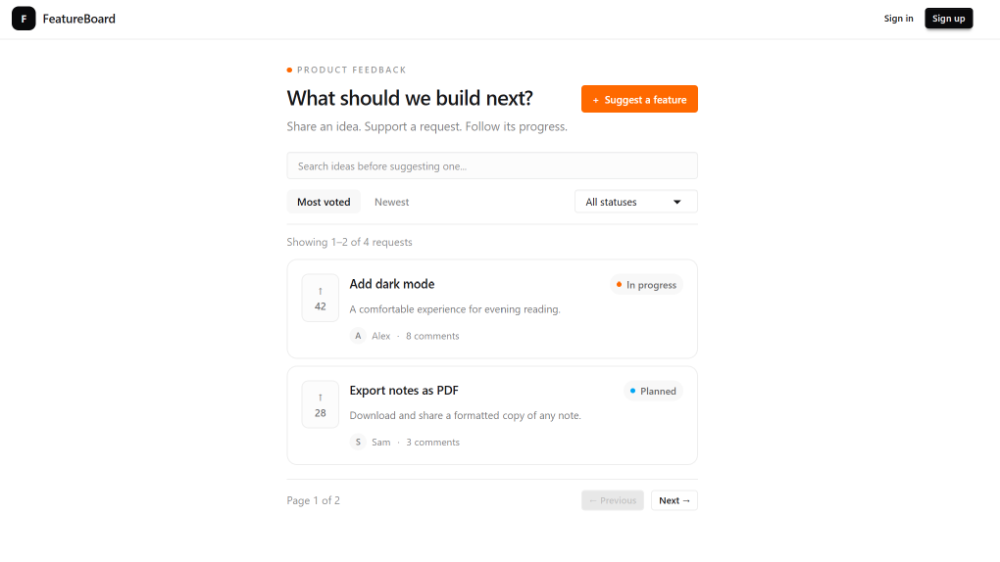
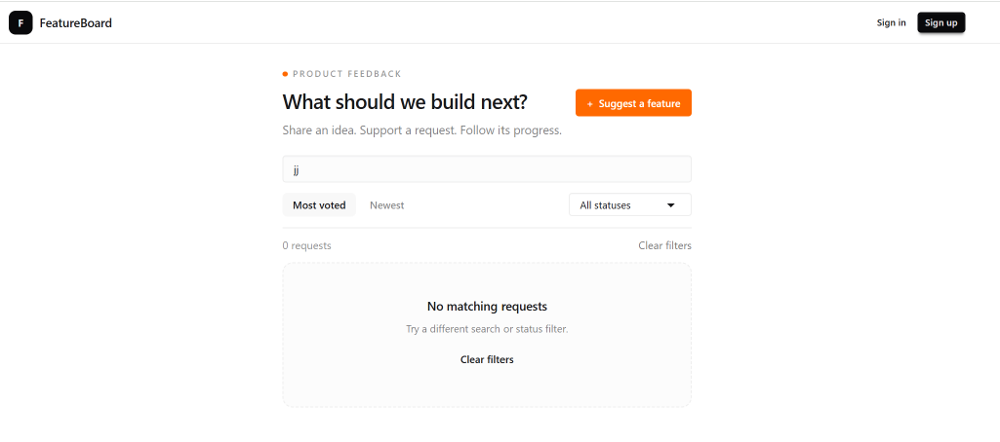

# Part 6 — Add search, filters, and pagination

Our homepage displays feature requests. Next, we’ll make the list searchable, filterable, and sortable.

We’ll also display four requests per page to keep the interface manageable.

The homepage will pass requests into an interactive list component. That component will manage the controls and decide which cards to display.

## Add a creation date to the request type

Open `features/requests/types.ts` and add `createdAt` to the request type.

The complete file should look like this:

```ts
export type RequestStatus =
  | "UNDER_REVIEW"
  | "PLANNED"
  | "IN_PROGRESS"
  | "COMPLETE";

export type FeatureRequest = {
  id: string;
  title: string;
  description: string;
  author: {
    id: string;
    name: string;
  };
  votes: number;
  comments: number;
  status: RequestStatus;
  createdAt: string;
};
```

The creation date lets us sort requests from newest to oldest.

We’ll use ISO date strings in our sample data.

## Update the sample data

Replace `features/requests/mock-data.ts` with:

```ts
import type { FeatureRequest } from "./types";

export const mockRequests: FeatureRequest[] = [
  {
    id: "1",
    title: "Add dark mode",
    description: "A comfortable experience for evening reading.",
    author: {
      id: "user-1",
      name: "Alex",
    },
    votes: 42,
    comments: 8,
    status: "IN_PROGRESS",
    createdAt: "2026-10-15T12:00:00Z",
  },
  {
    id: "2",
    title: "Export notes as PDF",
    description: "Download and share a formatted copy of any note.",
    author: {
      id: "user-2",
      name: "Sam",
    },
    votes: 28,
    comments: 3,
    status: "PLANNED",
    createdAt: "2026-10-16T12:00:00Z",
  },
  {
    id: "3",
    title: "Organize notes into folders",
    description: "Keep projects and related ideas together.",
    author: {
      id: "user-3",
      name: "Jordan",
    },
    votes: 16,
    comments: 5,
    status: "UNDER_REVIEW",
    createdAt: "2026-10-17T12:00:00Z",
  },
  {
    id: "4",
    title: "Search inside notes",
    description: "Find words and phrases across saved notes.",
    author: {
      id: "user-4",
      name: "Morgan",
    },
    votes: 11,
    comments: 2,
    status: "COMPLETE",
    createdAt: "2026-10-14T12:00:00Z",
  },
];
```

## Create the interactive request list

Create `features/requests/components/request-list.tsx`:

```tsx
"use client";

import { useState } from "react";
import type { FeatureRequest, RequestStatus } from "../types";
import { requestStatuses } from "../statuses";
import { RequestCard } from "./request-card";

type RequestListProps = {
  requests: FeatureRequest[];
};

type SortOrder = "votes" | "newest";

const PAGE_SIZE = 4;

const statusOptions = Object.entries(requestStatuses) as [
  RequestStatus,
  (typeof requestStatuses)[RequestStatus],
][];

function isRequestStatus(value: string): value is RequestStatus {
  return Object.prototype.hasOwnProperty.call(requestStatuses, value);
}

export function RequestList({ requests }: RequestListProps) {
  const [search, setSearch] = useState("");
  const [status, setStatus] = useState<RequestStatus | "ALL">("ALL");
  const [sort, setSort] = useState<SortOrder>("votes");
  const [page, setPage] = useState(1);

  const query = search.trim().toLowerCase();

  const filteredRequests = requests
    .filter((request) => {
      const matchesSearch =
        `${request.title} ${request.description}`
          .toLowerCase()
          .includes(query);

      const matchesStatus =
        status === "ALL" || request.status === status;

      return matchesSearch && matchesStatus;
    })
    .sort((a, b) => {
      if (sort === "newest") {
        return (
          Date.parse(b.createdAt) - Date.parse(a.createdAt) ||
          a.id.localeCompare(b.id)
        );
      }

      return b.votes - a.votes || a.id.localeCompare(b.id);
    });

  const totalResults = filteredRequests.length;
  const totalPages = Math.max(1, Math.ceil(totalResults / PAGE_SIZE));
  const currentPage = Math.min(page, totalPages);
  const startIndex = (currentPage - 1) * PAGE_SIZE;

  const visibleRequests = filteredRequests.slice(
    startIndex,
    startIndex + PAGE_SIZE,
  );

  const firstResult = totalResults === 0 ? 0 : startIndex + 1;
  const lastResult = Math.min(startIndex + PAGE_SIZE, totalResults);
  const hasFilters = query.length > 0 || status !== "ALL";

  function changeSort(value: SortOrder) {
    setSort(value);
    setPage(1);
  }

  function clearFilters() {
    setSearch("");
    setStatus("ALL");
    setPage(1);
  }

  return (
    <section aria-label="Browse feature requests" className="mt-5">
      <label htmlFor="request-search" className="sr-only">
        Search feature requests
      </label>

      <input
        id="request-search"
        type="search"
        value={search}
        onChange={(event) => {
          setSearch(event.target.value);
          setPage(1);
        }}
        placeholder="Search ideas before suggesting one..."
        className="input input-sm w-full border-base-300 bg-base-200/40 text-xs"
      />

      <div className="mt-3 flex flex-wrap items-center justify-between gap-2 border-b border-base-300 pb-3">
        <div
          role="group"
          aria-label="Sort requests"
          className="flex items-center gap-1"
        >
          <button
            type="button"
            onClick={() => changeSort("votes")}
            aria-pressed={sort === "votes"}
            className={`rounded-md px-3 py-1.5 text-xs font-medium transition-colors ${
              sort === "votes"
                ? "bg-base-200 text-base-content"
                : "text-base-content/50 hover:bg-base-200/60"
            }`}
          >
            Most voted
          </button>

          <button
            type="button"
            onClick={() => changeSort("newest")}
            aria-pressed={sort === "newest"}
            className={`rounded-md px-3 py-1.5 text-xs font-medium transition-colors ${
              sort === "newest"
                ? "bg-base-200 text-base-content"
                : "text-base-content/50 hover:bg-base-200/60"
            }`}
          >
            Newest
          </button>
        </div>

        <select
          aria-label="Filter requests by status"
          value={status}
          onChange={(event) => {
            const value = event.target.value;

            if (value === "ALL" || isRequestStatus(value)) {
              setStatus(value);
              setPage(1);
            }
          }}
          className="select select-xs w-36 border-base-300 bg-base-100 text-xs"
        >
          <option value="ALL">All statuses</option>

          {statusOptions.map(([value, configuration]) => (
            <option key={value} value={value}>
              {configuration.label}
            </option>
          ))}
        </select>
      </div>

      <div className="flex min-h-10 items-center justify-between gap-2">
        <p
          role="status"
          aria-live="polite"
          aria-atomic="true"
          className="text-[11px] text-base-content/50"
        >
          {totalResults === 0
            ? "No requests to show"
            : `Showing ${firstResult}–${lastResult} of ${totalResults} ${
                totalResults === 1 ? "request" : "requests"
              }`}
        </p>

        {hasFilters && (
          <button
            type="button"
            onClick={clearFilters}
            className="text-[11px] text-base-content/60 hover:underline"
          >
            Clear filters
          </button>
        )}
      </div>

      <div className="space-y-2">
        {visibleRequests.map((request) => (
          <RequestCard key={request.id} request={request} />
        ))}

        {totalResults === 0 && (
          <div className="rounded-xl border border-dashed border-base-300 bg-base-200/30 px-4 py-10 text-center">
            <h2 className="text-sm font-semibold">
              {hasFilters ? "No matching requests" : "No requests yet"}
            </h2>

            <p className="mt-2 text-xs text-base-content/55">
              {hasFilters
                ? "Try a different search or status filter."
                : "Be the first to suggest an improvement."}
            </p>

            {hasFilters && (
              <button
                type="button"
                onClick={clearFilters}
                className="btn btn-ghost btn-sm mt-3"
              >
                Clear filters
              </button>
            )}
          </div>
        )}
      </div>

      {totalPages > 1 && (
        <nav
          aria-label="Request pagination"
          className="mt-4 flex flex-wrap items-center justify-between gap-3 border-t border-base-300 pt-3"
        >
          <p className="text-[11px] text-base-content/50">
            Page {currentPage} of {totalPages}
          </p>

          <div className="flex gap-2">
            <button
              type="button"
              disabled={currentPage === 1}
              onClick={() => setPage(currentPage - 1)}
              className="btn btn-outline btn-xs border-base-300"
            >
              ← Previous
            </button>

            <button
              type="button"
              disabled={currentPage === totalPages}
              onClick={() => setPage(currentPage + 1)}
              className="btn btn-outline btn-xs border-base-300"
            >
              Next →
            </button>
          </div>
        </nav>
      )}
    </section>
  );
}
```

This component uses state and browser events, so it needs `"use client"`.

We store the search text, selected status, sort order, and page number in state. The visible requests are calculated from those values.

The order is important: filter first, sort second, and paginate last. That lets us search all supplied requests before selecting a page.

Filtering creates a new array, so sorting that array doesn’t change the original requests.

When two requests have the same vote count or creation date, their IDs provide a consistent secondary order.

The status check validates the dropdown value before storing it as a request status.

## Understand the pagination

`PAGE_SIZE` controls how many cards appear on each page. We’ve set it to four.

We divide the result count by the page size and round up to calculate the number of pages.

The current page is limited to the available page count. This prevents an empty page if the supplied data shrinks.

We calculate the starting position, then use `slice` to select that page’s requests.

Search, status, and sorting changes return the list to page one. The Previous and Next buttons are disabled at the boundaries.

Pagination controls appear only when there’s more than one page.

For now, this happens in the browser using sample data. When PostgreSQL is connected, we’ll move filtering, sorting, and pagination into the database query.

## Connect the homepage

Replace `app/page.tsx` with:

```tsx
import Link from "next/link";
import { RequestList } from "@/features/requests/components/request-list";
import { mockRequests } from "@/features/requests/mock-data";

export default function HomePage() {
  return (
    <main className="mx-auto max-w-4xl px-3 py-5 sm:px-4 sm:py-7">
      <div className="flex flex-col justify-between gap-4 sm:flex-row sm:items-center">
        <div>
          <p className="flex items-center gap-1.5 text-[9px] font-semibold uppercase tracking-[0.18em] text-base-content/45">
            <span
              aria-hidden="true"
              className="size-1.5 rounded-full bg-orange-500"
            />
            Product feedback
          </p>

          <h1 className="mt-2 text-2xl font-semibold tracking-tight">
            What should we build next?
          </h1>

          <p className="mt-2 text-sm text-base-content/55">
            Share an idea. Support a request. Follow its progress.
          </p>
        </div>

        <Link
          href="/requests/new"
          className="btn btn-sm shrink-0 self-start border-orange-500 bg-orange-500 text-white shadow-none hover:border-orange-600 hover:bg-orange-600 sm:self-auto"
        >
          <span aria-hidden="true">+</span>
          Suggest a feature
        </Link>
      </div>

      <RequestList requests={mockRequests} />
    </main>
  );
}
```

The homepage remains a Server Component and passes serializable request data into the interactive list.

The request card stays unchanged. Because the client component imports it, the card is included in the client component tree.

Our header and root layout remain unchanged.

## Check search and filtering

Open the homepage.

Search for “PDF”. Only the PDF request should appear.

Clear the search, then select Planned. The PDF request should remain.

Select All statuses, then choose Newest. The folders request should appear first.



## Check pagination

With four sample requests and a page size of four, the summary reads “Showing 1–4 of 4 requests”.

To test the pagination controls, temporarily change:

```ts
const PAGE_SIZE = 2;
```

Click Next. The summary should read “Showing 3–4 of 4 requests”.

Click Previous to return to the first page.

Go to page two again, then change the sort order. The list should return to page one.



After testing, restore the final page size:

```ts
const PAGE_SIZE = 4;
```

The pagination screenshot shows the temporary two-card test setting.

## Check the empty state

Search for “banana”.

The list should display an explanation and a Clear filters button.

Click Clear filters to restore the requests.



## Save the checkpoint

We’re still working on `feat/app-shell`.

Confirm that `PAGE_SIZE` is back to four, then review the changed files:

```bash
git status --short
```

Stage the feature changes, homepage, and documentation:

```bash
git add features/requests app/page.tsx docs/tutorial
```

Commit and upload:

```bash
git commit -m "feat: add request search filters and pagination"
git push
```

## Checkpoint

The homepage supports search, status filtering, sorting, and four requests per page.

It also handles empty results and resets pagination when the controls change.

These controls currently use local state, so refreshing the page resets them.

Next, we’ll build the request details route using our shared request data.