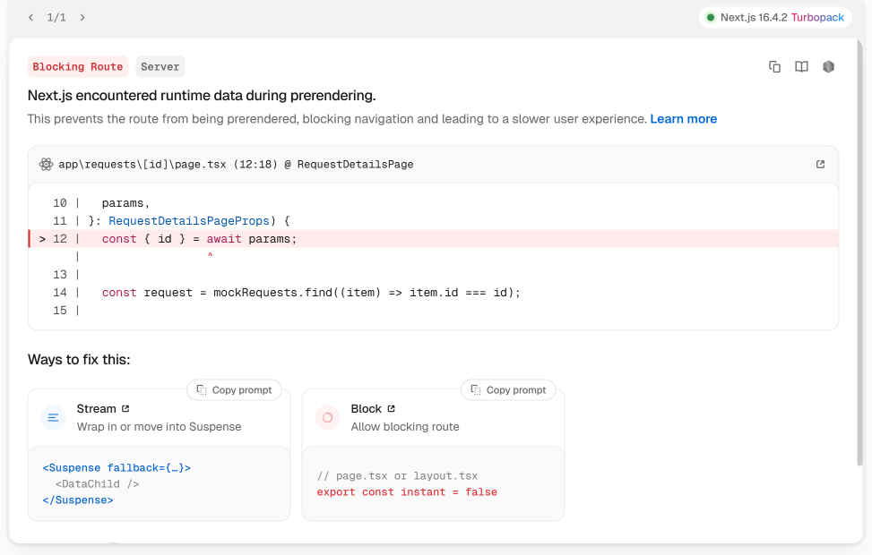
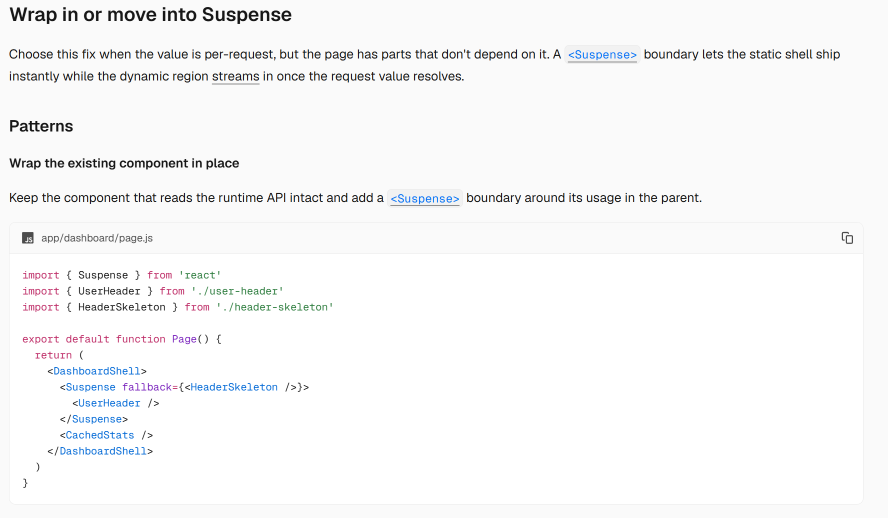
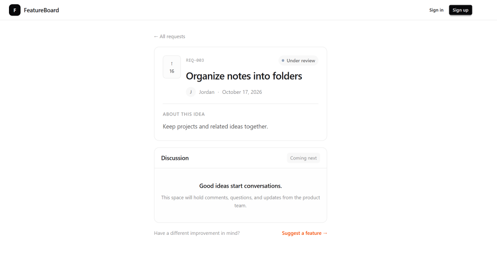

# Part 7 — Build the request details page

Our homepage displays feature requests. Next, we’ll let users open a request and read its full description.

We’ll reuse our request data and status badge. The shared header already comes from the root layout.

## Create the details component

Create `features/requests/components/request-details.tsx`:

```tsx
import Link from "next/link";
import type { FeatureRequest } from "../types";
import { RequestStatusBadge } from "./request-status-badge";

type RequestDetailsProps = {
  request: FeatureRequest;
};

export function RequestDetails({ request }: RequestDetailsProps) {
  const submittedDate = new Intl.DateTimeFormat("en-US", {
    month: "long",
    day: "numeric",
    year: "numeric",
    timeZone: "UTC",
  }).format(new Date(request.createdAt));

  return (
    <main className="mx-auto max-w-3xl px-3 py-5 sm:px-4 sm:py-7">
      <Link
        href="/"
        className="text-xs text-base-content/55 hover:text-base-content"
      >
        ← All requests
      </Link>

      <article className="mt-4 rounded-xl border border-base-300 p-4 sm:p-5">
        <div className="flex items-start gap-3">
          <div
            aria-label={`${request.votes} votes`}
            className="flex h-14 w-11 shrink-0 flex-col items-center justify-center gap-0.5 rounded-lg border border-base-300 bg-base-200/40 text-xs font-semibold text-base-content/65"
          >
            <span aria-hidden="true">↑</span>
            {request.votes}
          </div>

          <div className="min-w-0 flex-1">
            <div className="flex flex-wrap items-center justify-between gap-2">
              <span className="font-mono text-[10px] text-base-content/40">
                REQ-{request.id.padStart(3, "0")}
              </span>

              <RequestStatusBadge status={request.status} />
            </div>

            <h1 className="mt-2 break-words text-xl font-semibold tracking-tight sm:text-2xl">
              {request.title}
            </h1>

            <div className="mt-3 flex flex-wrap items-center gap-2 text-[11px] text-base-content/55">
              <span
                aria-hidden="true"
                className="flex size-6 items-center justify-center rounded-full bg-base-200 text-[10px] font-medium"
              >
                {request.author.name.charAt(0)}
              </span>

              <span>{request.author.name}</span>

              <span aria-hidden="true">·</span>

              <time dateTime={request.createdAt}>{submittedDate}</time>
            </div>
          </div>
        </div>

        <div className="mt-4 border-t border-base-300 pt-4">
          <h2 className="text-[10px] font-semibold uppercase tracking-wider text-base-content/45">
            About this idea
          </h2>

          <p className="mt-2 whitespace-pre-line break-words text-sm leading-7 text-base-content/75">
            {request.description}
          </p>
        </div>
      </article>

      <section
        id="comments"
        aria-labelledby="discussion-heading"
        className="mt-4 scroll-mt-4 overflow-hidden rounded-xl border border-base-300"
      >
        <div className="flex items-center justify-between gap-2 border-b border-base-300 px-4 py-3">
          <h2 id="discussion-heading" className="text-sm font-semibold">
            Discussion
          </h2>

          <span className="rounded-md bg-base-200 px-2 py-1 text-[10px] text-base-content/55">
            Coming next
          </span>
        </div>

        <div className="bg-base-200/20 px-4 py-8 text-center">
          <p className="text-sm font-medium">
            Good ideas start conversations.
          </p>

          <p className="mx-auto mt-2 max-w-sm text-xs leading-relaxed text-base-content/55">
            This space will hold comments, questions, and updates from
            the product team.
          </p>
        </div>
      </section>

      <div className="mt-4 flex flex-wrap items-center justify-between gap-3 text-xs">
        <p className="text-base-content/50">
          Have a different improvement in mind?
        </p>

        <Link
          href="/requests/new"
          className="font-medium text-orange-600 hover:underline"
        >
          Suggest a feature →
        </Link>
      </div>
    </main>
  );
}
```

This component receives a request and renders its details.

We format the creation date for display and use an explicit UTC timezone for consistent output.

The `time` element keeps the original date in its `dateTime` attribute.

The description uses `whitespace-pre-line` to preserve paragraph breaks.

Voting remains display-only. The discussion area is a placeholder until we connect comments.

## Add a longer sample description

Open `features/requests/mock-data.ts`.

Replace the description for request one with:

```ts
description:
  "A dark theme would make the app more comfortable to use at night.\n\nIt would be helpful to choose between light mode, dark mode, and a setting that follows the device theme.",
```

The `\n\n` creates a paragraph break on the details page.

## Keep homepage cards compact

Open `features/requests/components/request-card.tsx`.

Update the description paragraph to include `line-clamp-2`:

```tsx
<p className="mt-1.5 line-clamp-2 break-words text-xs leading-relaxed text-base-content/60">
  {request.description}
</p>
```

The homepage shows a two-line preview. The details page shows the full description.

## Understand the dynamic route

Create a folder named `[id]` inside `app/requests`.

The square brackets make this a dynamic route.

For example, `/requests/1` provides an ID of `"1"`. We use that value to find the matching request.

During this build, our first implementation read the route parameters directly in the page:

```tsx
const { id } = await params;
```

The page displayed, but Next.js reported a blocking-route error at that line.



## Resolve the prerendering error

In our Next.js setup, the route parameters weren’t available during prerendering. Reading them required a Suspense boundary.

Suspense provides fallback content while the component inside it waits for a value.

The boundary must be above the component that reads the runtime data. Adding a boundary after `await params` would be too late.

The Next.js documentation describes this pattern:

https://nextjs.org/docs/messages/blocking-prerender-runtime#wrap-in-or-move-into-suspense



We’ll keep the page synchronous and move the parameter read into an async child component.

## Create the route with Suspense

Create `app/requests/[id]/page.tsx`:

```tsx
import { Suspense } from "react";
import { notFound } from "next/navigation";
import { RequestDetails } from "@/features/requests/components/request-details";
import { mockRequests } from "@/features/requests/mock-data";

type RequestDetailsPageProps = {
  params: Promise<{ id: string }>;
};

export default function RequestDetailsPage({
  params,
}: RequestDetailsPageProps) {
  return (
    <Suspense fallback={<RequestDetailsFallback />}>
      <RequestDetailsContent params={params} />
    </Suspense>
  );
}

async function RequestDetailsContent({
  params,
}: RequestDetailsPageProps) {
  const { id } = await params;

  const request = mockRequests.find((item) => item.id === id);

  if (!request) {
    notFound();
  }

  return <RequestDetails request={request} />;
}

function RequestDetailsFallback() {
  return (
    <main
      aria-busy="true"
      className="mx-auto max-w-3xl px-3 py-5 sm:px-4 sm:py-7"
    >
      <p role="status" className="text-xs text-base-content/55">
        Loading request…
      </p>

      <div
        aria-hidden="true"
        className="mt-4 rounded-xl border border-base-300 p-4 sm:p-5"
      >
        <div className="skeleton h-5 w-24" />
        <div className="skeleton mt-4 h-7 w-3/4" />
        <div className="skeleton mt-3 h-4 w-40" />

        <div className="mt-5 space-y-2 border-t border-base-300 pt-4">
          <div className="skeleton h-4 w-full" />
          <div className="skeleton h-4 w-full" />
          <div className="skeleton h-4 w-2/3" />
        </div>
      </div>
    </main>
  );
}
```

The page renders the Suspense boundary.

Inside that boundary, `RequestDetailsContent` awaits the parameters, finds the request, and renders its details.

If no matching request exists, `notFound` renders the nearest not-found interface.

The fallback uses DaisyUI skeletons to suggest the shape of the loading content. The skeletons are decorative, while the loading message communicates the state to assistive technology.

The shared header sits outside this boundary in the root layout, so it can remain visible while the request content resolves.

With sample data, the fallback may appear too briefly to notice.

## Check the result

Open the homepage and click Add dark mode.

Confirm that the page displays the title, status, vote count, author, date, and full description.

Click All requests to return to the homepage.

Open `/requests/999` to confirm that an unknown ID displays a not-found page.

Return to `/requests/1` and confirm that the blocking-route error no longer appears.



## Save the checkpoint

We’re still working on `feat/app-shell`.

Review the changed files:

```bash
git status --short
```

Stage the request components, sample data, route, and documentation:

```bash
git add features/requests app/requests docs/tutorial
```

Commit and upload:

```bash
git commit -m "feat: add request details route with Suspense"
git push
```

## Checkpoint

Users can open a request from the homepage and read its full description.

Unknown IDs display a not-found page. Runtime route parameters are read inside a Suspense boundary.

Next, we’ll build the feature submission form.