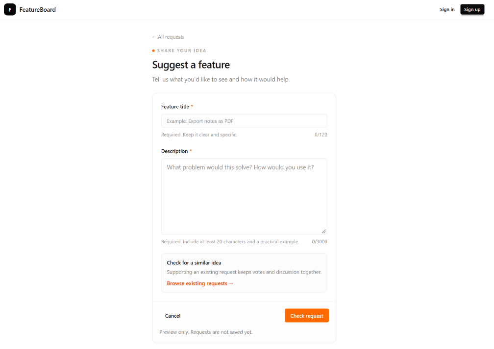

# Part 8 — Build the feature submission form

Users can browse requests and open their details. Next, we’ll build the form for suggesting a feature.

We’ll separate the page layout from the interactive form. The page provides the introduction, while the form manages its inputs and validation feedback.

This step checks the form without saving a request. We’ll connect authenticated submissions after setting up the database.

## Create the form component

Create `features/requests/components/request-form.tsx`:

```tsx
"use client";

import Link from "next/link";
import { useState, type FormEvent } from "react";

export function RequestForm() {
  const [title, setTitle] = useState("");
  const [description, setDescription] = useState("");
  const [notice, setNotice] = useState("");

  function handleSubmit(event: FormEvent<HTMLFormElement>) {
    event.preventDefault();

    if (title.trim().length < 5) {
      setNotice("Enter a title with at least 5 non-padding characters.");
      return;
    }

    if (description.trim().length < 20) {
      setNotice(
        "Enter a description with at least 20 non-padding characters.",
      );
      return;
    }

    setNotice(
      "Your form passed the preview checks. Saving will be connected after authentication and database setup.",
    );
  }

  return (
    <form
      onSubmit={handleSubmit}
      className="mt-5 overflow-hidden rounded-xl border border-base-300"
    >
      <div className="space-y-5 p-4 sm:p-5">
        <div>
          <label htmlFor="title" className="text-xs font-semibold">
            Feature title
            <span aria-hidden="true" className="ml-1 text-orange-600">
              *
            </span>
          </label>

          <input
            id="title"
            name="title"
            type="text"
            value={title}
            onChange={(event) => {
              setTitle(event.target.value);
              setNotice("");
            }}
            required
            minLength={5}
            maxLength={120}
            placeholder="Example: Export notes as PDF"
            aria-describedby="title-hint title-count"
            className="input input-sm mt-2 w-full border-base-300 bg-base-100 text-xs"
          />

          <div className="mt-2 flex justify-between gap-3 text-[10px] text-base-content/50">
            <p id="title-hint">Required. Keep it clear and specific.</p>
            <span id="title-count" className="shrink-0">
              {title.length}/120
            </span>
          </div>
        </div>

        <div>
          <label htmlFor="description" className="text-xs font-semibold">
            Description
            <span aria-hidden="true" className="ml-1 text-orange-600">
              *
            </span>
          </label>

          <textarea
            id="description"
            name="description"
            value={description}
            onChange={(event) => {
              setDescription(event.target.value);
              setNotice("");
            }}
            required
            minLength={20}
            maxLength={3000}
            rows={7}
            placeholder="What problem would this solve? How would you use it?"
            aria-describedby="description-hint description-count"
            className="textarea mt-2 w-full resize-y border-base-300 bg-base-100 text-sm leading-relaxed"
          />

          <div className="mt-2 flex justify-between gap-3 text-[10px] text-base-content/50">
            <p id="description-hint">
              Required. Include at least 20 characters and a practical example.
            </p>
            <span id="description-count" className="shrink-0">
              {description.length}/3000
            </span>
          </div>
        </div>

        <div className="rounded-lg border border-base-300 bg-base-200/40 p-3">
          <p className="text-xs font-medium">Check for a similar idea</p>

          <p className="mt-1 text-xs leading-relaxed text-base-content/55">
            Supporting an existing request keeps votes and discussion together.
          </p>

          <Link
            href="/"
            className="mt-2 inline-block text-[11px] font-medium text-orange-600 hover:underline"
          >
            Browse existing requests →
          </Link>
        </div>
      </div>

      <div className="border-t border-base-300 bg-base-200/20 p-4">
        <div className="flex items-center justify-between gap-3">
          <Link href="/" className="btn btn-ghost btn-sm">
            Cancel
          </Link>

          <button
            type="submit"
            className="btn btn-sm border-orange-500 bg-orange-500 text-white shadow-none hover:border-orange-600 hover:bg-orange-600"
          >
            Check request
          </button>
        </div>

        <p
          role="status"
          aria-live="polite"
          aria-atomic="true"
          className="mt-3 text-xs leading-relaxed text-base-content/60"
        >
          {notice || "Preview only. Requests are not saved yet."}
        </p>
      </div>
    </form>
  );
}
```

The form uses React state to track the title, description, and feedback message.

Each input is controlled: its value comes from state, and its change handler updates that state.

The character counts use the same values, so they update as we type.

Changing either field clears the previous feedback message.

## Understand the validation

The HTML attributes provide browser validation.

The title is required and accepts between 5 and 120 characters. The description is required and accepts between 20 and 3,000 characters.

The submit handler also checks the trimmed values. Trimming removes whitespace from the beginning and end, preventing spaces alone from satisfying the minimum length.

The handler calls `preventDefault` to stop the browser from submitting the form and navigating away.

If the checks pass, we display a preview message. We keep the entered text so the user can continue editing.

These checks improve the user experience, but they aren’t a security boundary. When saving is connected, we’ll validate the input and verify the user’s session on the server.

## Create the submission route

Create `app/requests/new/page.tsx`:

```tsx
import Link from "next/link";
import { RequestForm } from "@/features/requests/components/request-form";

export default function NewRequestPage() {
  return (
    <main className="mx-auto max-w-2xl px-3 py-5 sm:px-4 sm:py-7">
      <Link
        href="/"
        className="text-xs text-base-content/55 hover:text-base-content"
      >
        ← All requests
      </Link>

      <div className="mt-4">
        <p className="flex items-center gap-1.5 text-[9px] font-semibold uppercase tracking-[0.18em] text-base-content/45">
          <span
            aria-hidden="true"
            className="size-1.5 rounded-full bg-orange-500"
          />
          Share your idea
        </p>

        <h1 className="mt-2 text-2xl font-semibold tracking-tight">
          Suggest a feature
        </h1>

        <p className="mt-2 text-sm leading-relaxed text-base-content/55">
          Tell us what you’d like to see and how it would help.
        </p>
      </div>

      <RequestForm />
    </main>
  );
}
```

The page remains a Server Component. Only the form needs `"use client"` because it uses state and event handlers.

The static `/requests/new` route takes precedence over the dynamic `/requests/[id]` route. Next.js treats `new` as this page rather than a request ID.

The shared header continues to come from the root layout.

## Check the result

Click Suggest a feature on the homepage.

Submit the empty form. The browser should identify the required fields.

Enter a title and description that meet the minimum lengths, then click Check request.

The preview message should appear, and the entered text should remain.

Confirm that the character counts update while typing.

Check that Cancel, All requests, and Browse existing requests return to the homepage.

<!-- Save the form screenshot as images/08-request-form.png. -->



## Save the checkpoint

We’re still working on `feat/app-shell`.

Review the changed files:

```bash
git status --short
```

Stage the form, route, and documentation:

```bash
git add features/requests/components/request-form.tsx app/requests/new/page.tsx docs/tutorial
```

Commit and upload:

```bash
git commit -m "feat: add feature request form preview"
git push
```

## Checkpoint

The submission page displays a reusable form with character counts and client-side validation.

The form checks input without saving a request.

Next, we’ll build the sign-in and sign-up screens.