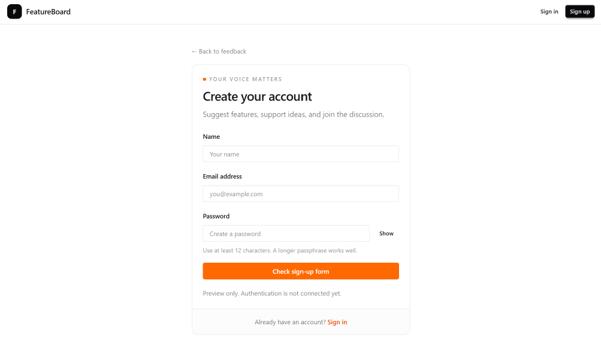
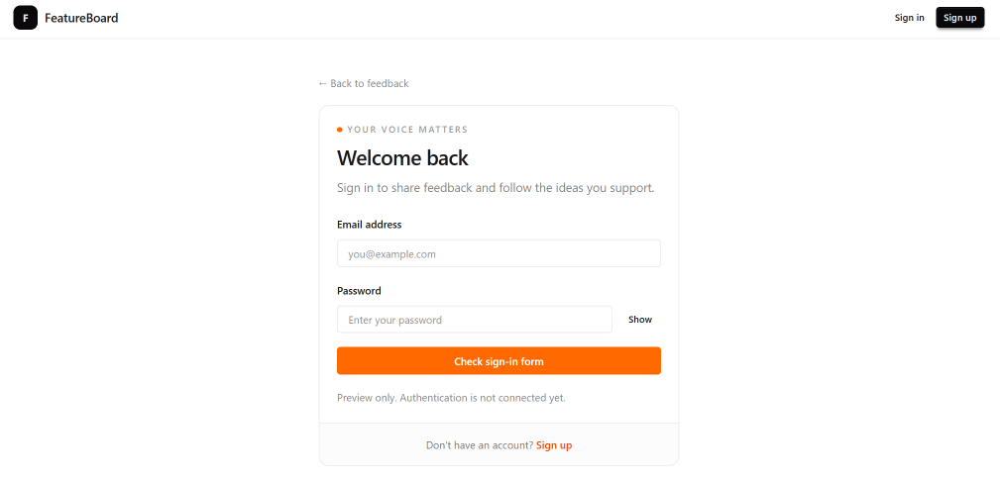

# Part 9 — Build the sign-in and sign-up screens

Our application has a shared header, a request list, a details page, and a submission form.

Next, we’ll build the authentication screens.

Both screens will share a card layout and a form component. The form will display different fields depending on whether the user is signing in or creating an account.

These screens are previews. We’ll connect authentication after setting up the database.

## Create the shared authentication card

Create `features/auth/components/auth-card.tsx`:

```tsx
import Link from "next/link";
import type { ReactNode } from "react";

type AuthCardProps = {
  title: string;
  description: string;
  children: ReactNode;
  footer: ReactNode;
};

export function AuthCard({
  title,
  description,
  children,
  footer,
}: AuthCardProps) {
  return (
    <main className="mx-auto w-full max-w-md px-3 py-5 sm:px-4 sm:py-10">
      <Link
        href="/"
        className="text-xs text-base-content/55 hover:text-base-content"
      >
        ← Back to feedback
      </Link>

      <section className="mt-4 overflow-hidden rounded-xl border border-base-300">
        <div className="p-4 sm:p-5">
          <p className="flex items-center gap-1.5 text-[9px] font-semibold uppercase tracking-[0.18em] text-base-content/45">
            <span
              aria-hidden="true"
              className="size-1.5 rounded-full bg-orange-500"
            />
            Your voice matters
          </p>

          <h1 className="mt-2 text-2xl font-semibold tracking-tight">
            {title}
          </h1>

          <p className="mt-2 text-sm leading-relaxed text-base-content/55">
            {description}
          </p>

          {children}
        </div>

        <div className="border-t border-base-300 bg-base-200/30 px-4 py-4 text-center text-xs text-base-content/60">
          {footer}
        </div>
      </section>
    </main>
  );
}
```

The card owns the shared layout and styling.

The page supplies its title, description, form, and footer through props.

`ReactNode` allows the children and footer to contain elements, text, or a combination of both.

This component doesn’t need browser state, so it remains a Server Component.

## Create the shared form

Create `features/auth/components/auth-form.tsx`:

```tsx
"use client";

import { useState, type FormEvent } from "react";

type AuthFormProps = {
  mode: "sign-in" | "sign-up";
};

export function AuthForm({ mode }: AuthFormProps) {
  const isSignUp = mode === "sign-up";

  const [showPassword, setShowPassword] = useState(false);
  const [notice, setNotice] = useState("");

  function handleSubmit(event: FormEvent<HTMLFormElement>) {
    event.preventDefault();

    const formData = new FormData(event.currentTarget);
    const name = String(formData.get("name") ?? "").trim();

    if (isSignUp && name.length < 2) {
      setNotice("Enter a name with at least two characters.");
      return;
    }

    setNotice(
      isSignUp
        ? "The form passed the preview checks. Account creation is not connected yet."
        : "The form passed the preview checks. Sign-in is not connected yet.",
    );
  }

  return (
    <form
      onSubmit={handleSubmit}
      onChange={() => setNotice("")}
      className="mt-5 space-y-4"
    >
      {isSignUp && (
        <div>
          <label htmlFor="name" className="text-xs font-semibold">
            Name
          </label>

          <input
            id="name"
            name="name"
            type="text"
            autoComplete="name"
            required
            minLength={2}
            maxLength={80}
            placeholder="Your name"
            className="input input-sm mt-2 w-full border-base-300 bg-base-100 text-xs"
          />
        </div>
      )}

      <div>
        <label htmlFor="email" className="text-xs font-semibold">
          Email address
        </label>

        <input
          id="email"
          name="email"
          type="email"
          autoComplete="email"
          required
          placeholder="you@example.com"
          className="input input-sm mt-2 w-full border-base-300 bg-base-100 text-xs"
        />
      </div>

      <div>
        <label htmlFor="password" className="text-xs font-semibold">
          Password
        </label>

        <div className="mt-2 flex items-center gap-2">
          <input
            id="password"
            name="password"
            type={showPassword ? "text" : "password"}
            autoComplete={isSignUp ? "new-password" : "current-password"}
            required
            minLength={isSignUp ? 12 : undefined}
            maxLength={128}
            placeholder={
              isSignUp ? "Create a password" : "Enter your password"
            }
            aria-describedby={isSignUp ? "password-hint" : undefined}
            className="input input-sm min-w-0 flex-1 border-base-300 bg-base-100 text-xs"
          />

          <button
            type="button"
            onClick={() => setShowPassword((current) => !current)}
            aria-controls="password"
            aria-pressed={showPassword}
            aria-label="Show password"
            className="btn btn-ghost btn-xs w-12 shrink-0"
          >
            {showPassword ? "Hide" : "Show"}
          </button>
        </div>

        {isSignUp && (
          <p
            id="password-hint"
            className="mt-2 text-[10px] text-base-content/50"
          >
            Use at least 12 characters. A longer passphrase works well.
          </p>
        )}
      </div>

      <button
        type="submit"
        className="btn btn-sm w-full border-orange-500 bg-orange-500 text-white shadow-none hover:border-orange-600 hover:bg-orange-600"
      >
        {isSignUp ? "Check sign-up form" : "Check sign-in form"}
      </button>

      <p
        role="status"
        aria-live="polite"
        aria-atomic="true"
        className="text-xs leading-relaxed text-base-content/55"
      >
        {notice || "Preview only. Authentication is not connected yet."}
      </p>
    </form>
  );
}
```

The `mode` prop accepts two values: `sign-in` and `sign-up`.

In sign-up mode, the form includes a name field and requires a password of at least 12 characters.

In sign-in mode, the form asks for the existing email address and password.

The autocomplete attributes help browsers and password managers identify each field.

## Read the form values

These inputs don’t store their text in React state.

Instead, the submit handler creates a `FormData` object from the form. Each input’s `name` attribute identifies its value.

We trim the name before checking its length so leading and trailing spaces don’t satisfy the requirement.

The browser checks required fields, email formatting, and applicable length limits before calling the submit handler.

When those checks pass, we display a preview message. We don’t create an account or verify credentials yet.

Client-side checks improve usability. The authentication backend will enforce its own validation and password policy.

## Toggle password visibility

The password visibility button changes the input type between `password` and `text`.

Its `type="button"` prevents it from submitting the form.

The button exposes its pressed state and identifies the input it controls.

The feedback message uses a live region so assistive technology can announce changes without moving focus.

## Create the sign-up page

Create `app/sign-up/page.tsx`:

```tsx
import Link from "next/link";
import { AuthCard } from "@/features/auth/components/auth-card";
import { AuthForm } from "@/features/auth/components/auth-form";

export default function SignUpPage() {
  return (
    <AuthCard
      title="Create your account"
      description="Suggest features, support ideas, and join the discussion."
      footer={
        <>
          Already have an account?{" "}
          <Link
            href="/sign-in"
            className="font-medium text-orange-600 hover:underline"
          >
            Sign in
          </Link>
        </>
      }
    >
      <AuthForm mode="sign-up" />
    </AuthCard>
  );
}
```

The page supplies the sign-up content and selects the form’s sign-up mode.

## Create the sign-in page

Create `app/sign-in/page.tsx`:

```tsx
import Link from "next/link";
import { AuthCard } from "@/features/auth/components/auth-card";
import { AuthForm } from "@/features/auth/components/auth-form";

export default function SignInPage() {
  return (
    <AuthCard
      title="Welcome back"
      description="Sign in to share feedback and follow the ideas you support."
      footer={
        <>
          Don’t have an account?{" "}
          <Link
            href="/sign-up"
            className="font-medium text-orange-600 hover:underline"
          >
            Sign up
          </Link>
        </>
      }
    >
      <AuthForm mode="sign-in" />
    </AuthCard>
  );
}
```

Both pages reuse the same components. Their content and form mode are the only differences.

The shared application header continues to come from the root layout.

## Check sign-up

Open `/sign-up`.

Confirm that the form displays name, email, and password fields.

Submit an empty form to check required-field validation.

Enter an invalid email to check email validation.

Enter a password shorter than 12 characters to check the sign-up length requirement.

Use fictional details and a disposable test password when capturing screenshots.

Toggle Show and Hide, then submit valid input. The preview message should appear.



## Check sign-in

Open `/sign-in`.

Confirm that the name field is absent.

Enter a validly formatted email address and a test password. Submit the form and confirm that the preview message appears.

This message confirms the form checks passed. It doesn’t mean the credentials were authenticated.

Check the footer links between both screens and the Back to feedback link.



## Save the checkpoint

We’re still working on `feat/app-shell`.

Review the changed files:

```bash
git status --short
```

Stage the authentication components, routes, and documentation:

```bash
git add features/auth app/sign-in app/sign-up docs/tutorial
```

Commit and upload:

```bash
git commit -m "feat: add shared sign-in and sign-up screens"
git push
```

## Checkpoint

The application has matching sign-in and sign-up screens with shared components, browser validation, and password visibility controls.

Authentication is not connected yet. No accounts are created, and no sessions are established.

Next, we’ll build the modular admin board.