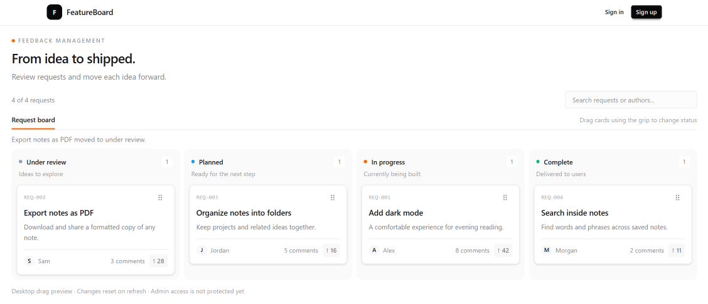

# Part 10 — Build the admin request board

Our public pages are ready for backend integration. Next, we’ll build the admin workspace.

The board groups requests into four status columns. Dragging a card into another column changes its status.

We’ll separate the board into three components:

- The card displays a request.
- The column displays a status and its cards.
- The board manages search, dragging, and request state.

This step is a desktop UI preview. Database persistence, admin authorization, and touch and keyboard movement will be added before production.

## Create the admin request card

Create `features/requests/components/admin-request-card.tsx`:

```tsx
import Link from "next/link";
import type { DragEvent } from "react";
import type { FeatureRequest } from "../types";

type AdminRequestCardProps = {
  request: FeatureRequest;
  isDragging: boolean;
  onDragStart: (
    event: DragEvent<HTMLDivElement>,
    requestId: string,
  ) => void;
  onDragEnd: () => void;
};

export function AdminRequestCard({
  request,
  isDragging,
  onDragStart,
  onDragEnd,
}: AdminRequestCardProps) {
  return (
    <article
      className={`min-w-0 rounded-lg border border-base-300 bg-base-100 p-3 shadow-sm transition-opacity ${
        isDragging ? "opacity-40" : "opacity-100"
      }`}
    >
      <div className="flex items-center justify-between gap-2">
        <span className="font-mono text-[9px] text-base-content/40">
          REQ-{request.id.padStart(3, "0")}
        </span>

        <div
          draggable
          onDragStart={(event) => onDragStart(event, request.id)}
          onDragEnd={onDragEnd}
          title={`Drag ${request.title} to another column`}
          className="-my-1 cursor-grab select-none rounded px-2 py-1 text-base-content/45 hover:bg-base-200 active:cursor-grabbing"
        >
          <span aria-hidden="true">⠿</span>
        </div>
      </div>

      <h3 className="mt-2 break-words text-sm font-semibold leading-snug">
        <Link
          href={`/requests/${request.id}`}
          draggable={false}
          className="hover:underline"
        >
          {request.title}
        </Link>
      </h3>

      <p className="mt-1.5 line-clamp-2 break-words text-xs leading-relaxed text-base-content/60">
        {request.description}
      </p>

      <div className="mt-3 flex flex-wrap items-center justify-between gap-2 border-t border-base-300 pt-2">
        <span className="flex min-w-0 items-center gap-1.5">
          <span
            aria-hidden="true"
            className="flex size-5 shrink-0 items-center justify-center rounded-full bg-base-200 text-[9px] font-medium"
          >
            {request.author.name.charAt(0)}
          </span>

          <span className="truncate text-[10px] text-base-content/55">
            {request.author.name}
          </span>
        </span>

        <div className="flex items-center gap-2 text-[10px] text-base-content/55">
          <Link
            href={`/requests/${request.id}#comments`}
            className="hover:underline"
          >
            {request.comments} comments
          </Link>

          <span className="rounded bg-base-200 px-1.5 py-1 font-medium">
            ↑ {request.votes}
          </span>
        </div>
      </div>
    </article>
  );
}
```

The card receives its data and event handlers through props. It doesn’t own the request list or decide which column contains it.

The grip is the drag handle. Keeping dragging on the grip allows the title and comment links to remain normal navigation controls.

While the card is being dragged, we reduce its opacity.

The description is limited to two lines to keep cards compact.

## Create the board column

Create `features/requests/components/admin-board-column.tsx`:

```tsx
import type { DragEvent, ReactNode } from "react";
import type { RequestStatus } from "../types";
import { requestStatuses } from "../statuses";

type AdminBoardColumnProps = {
  status: RequestStatus;
  count: number;
  isOver: boolean;
  isSearching: boolean;
  children: ReactNode;
  onDragOver: (event: DragEvent<HTMLElement>) => void;
  onDragLeave: (event: DragEvent<HTMLElement>) => void;
  onDrop: (event: DragEvent<HTMLElement>) => void;
};

const descriptions: Record<RequestStatus, string> = {
  UNDER_REVIEW: "Ideas to explore",
  PLANNED: "Ready for the next step",
  IN_PROGRESS: "Currently being built",
  COMPLETE: "Delivered to users",
};

export function AdminBoardColumn({
  status,
  count,
  isOver,
  isSearching,
  children,
  onDragOver,
  onDragLeave,
  onDrop,
}: AdminBoardColumnProps) {
  const configuration = requestStatuses[status];

  return (
    <section
      aria-label={`${configuration.label} requests`}
      onDragOver={onDragOver}
      onDragLeave={onDragLeave}
      onDrop={onDrop}
      className={`min-w-0 rounded-xl border p-2 transition-colors ${
        isOver
          ? "border-orange-500 bg-orange-500/10"
          : "border-transparent bg-base-200/70"
      }`}
    >
      <div className="px-1 pb-3 pt-1">
        <div className="flex items-center justify-between gap-2">
          <h2 className="flex items-center gap-2 text-xs font-semibold">
            <span
              aria-hidden="true"
              className={`size-1.5 rounded-full ${configuration.dotClass}`}
            />
            {configuration.label}
          </h2>

          <span className="flex size-5 items-center justify-center rounded bg-base-100 text-[10px] text-base-content/55">
            {count}
          </span>
        </div>

        <p className="mt-1 text-[10px] text-base-content/45">
          {descriptions[status]}
        </p>
      </div>

      <div className="min-h-40 space-y-2">
        {children}

        {count === 0 && (
          <div
            className={`flex min-h-40 items-center justify-center rounded-lg border border-dashed px-2 text-center text-xs ${
              isOver
                ? "border-orange-500 text-orange-600"
                : "border-base-content/15 text-base-content/45"
            }`}
          >
            {isOver
              ? "Drop request here"
              : isSearching
                ? "No matching requests"
                : "Drop a request here"}
          </div>
        )}
      </div>
    </section>
  );
}
```

The column reuses our shared status labels and colors.

Its cards arrive through `children`, while the board provides drag event handlers.

An empty column retains a minimum height so it remains a usable drop target.

The empty message distinguishes a column with no requests from a search with no matches.

## Create the interactive board

Create `features/requests/components/admin-request-board.tsx`:

```tsx
"use client";

import { useState, type DragEvent } from "react";
import type { FeatureRequest, RequestStatus } from "../types";
import { requestStatuses } from "../statuses";
import { AdminBoardColumn } from "./admin-board-column";
import { AdminRequestCard } from "./admin-request-card";

type AdminRequestBoardProps = {
  initialRequests: FeatureRequest[];
};

const statuses = Object.keys(requestStatuses) as RequestStatus[];

export function AdminRequestBoard({
  initialRequests,
}: AdminRequestBoardProps) {
  const [requests, setRequests] = useState(initialRequests);
  const [search, setSearch] = useState("");
  const [draggedId, setDraggedId] = useState<string | null>(null);
  const [overStatus, setOverStatus] = useState<RequestStatus | null>(null);
  const [notice, setNotice] = useState("");

  function moveRequest(id: string, status: RequestStatus) {
    const request = requests.find((item) => item.id === id);

    if (!request || request.status === status) return;

    setRequests((current) =>
      current.map((item) =>
        item.id === id ? { ...item, status } : item,
      ),
    );

    setNotice(
      `${request.title} moved to ${requestStatuses[status].label.toLowerCase()}.`,
    );
  }

  function startDrag(
    event: DragEvent<HTMLDivElement>,
    requestId: string,
  ) {
    event.dataTransfer.setData("text/plain", requestId);
    event.dataTransfer.effectAllowed = "move";

    setDraggedId(requestId);
    setNotice("");
  }

  function endDrag() {
    setDraggedId(null);
    setOverStatus(null);
  }

  function dropRequest(
    event: DragEvent<HTMLElement>,
    status: RequestStatus,
  ) {
    event.preventDefault();

    if (draggedId) {
      moveRequest(draggedId, status);
    }

    endDrag();
  }

  const query = search.trim().toLowerCase();

  const visibleRequests = requests.filter((request) =>
    `${request.title} ${request.description} ${request.author.name}`
      .toLowerCase()
      .includes(query),
  );

  return (
    <div className="mt-4">
      <div className="flex flex-col justify-between gap-3 sm:flex-row sm:items-center">
        <p className="text-xs text-base-content/55">
          {visibleRequests.length} of {requests.length} requests
        </p>

        <input
          type="search"
          aria-label="Search admin requests"
          value={search}
          onChange={(event) => setSearch(event.target.value)}
          placeholder="Search requests or authors..."
          className="input input-sm w-full border-base-300 bg-base-200/40 text-xs sm:w-60"
        />
      </div>

      <div className="mt-3 flex flex-wrap items-center justify-between gap-2 border-b border-base-300">
        <span className="border-b-2 border-orange-500 pb-2 text-xs font-medium">
          Request board
        </span>

        <span className="pb-2 text-[10px] text-base-content/45">
          Drag cards using the grip to change status
        </span>
      </div>

      <p
        role="status"
        aria-live="polite"
        aria-atomic="true"
        className="mt-2 min-h-4 text-[11px] text-base-content/55"
      >
        {notice}
      </p>

      <div className="mt-2 grid items-stretch gap-2 sm:grid-cols-2 lg:grid-cols-4">
        {statuses.map((status) => {
          const items = visibleRequests
            .filter((request) => request.status === status)
            .sort(
              (a, b) =>
                b.votes - a.votes || a.id.localeCompare(b.id),
            );

          return (
            <AdminBoardColumn
              key={status}
              status={status}
              count={items.length}
              isOver={overStatus === status}
              isSearching={query.length > 0}
              onDragOver={(event) => {
                if (!draggedId) return;

                event.preventDefault();
                event.dataTransfer.dropEffect = "move";
                setOverStatus(status);
              }}
              onDragLeave={(event) => {
                const nextTarget = event.relatedTarget;

                if (
                  nextTarget instanceof Node &&
                  event.currentTarget.contains(nextTarget)
                ) {
                  return;
                }

                setOverStatus((current) =>
                  current === status ? null : current,
                );
              }}
              onDrop={(event) => dropRequest(event, status)}
            >
              {items.map((request) => (
                <AdminRequestCard
                  key={request.id}
                  request={request}
                  isDragging={draggedId === request.id}
                  onDragStart={startDrag}
                  onDragEnd={endDrag}
                />
              ))}
            </AdminBoardColumn>
          );
        })}
      </div>

      <p className="mt-3 text-[10px] text-base-content/45">
        Desktop drag preview · Changes reset on refresh · Admin access
        is not protected yet
      </p>
    </div>
  );
}
```

The board owns the mutable request list.

We also track the search text, dragged request ID, highlighted destination, and feedback message.

The card and column components are imported by this client component, so they are part of its client component tree.

## Understand the drag interaction

When dragging starts, we record the request ID and identify the browser operation as a move.

When the card passes over a column, we call `preventDefault` to allow dropping and highlight that column.

Moving between elements inside the same column shouldn’t clear its highlight. The drag-leave handler checks whether the pointer is still within the column.

When the card is dropped, we update its status using a new array and a new object for the changed request.

React renders the card in its new column because column membership is derived from request status.

We then clear the drag state. The drag-end handler also clears it if the user cancels the drag.

Dropping into the existing status makes no change.

Cards remain sorted by votes within each column. We aren’t saving an exact card position.

## Create the admin route

Create `app/admin/page.tsx`:

```tsx
import { AdminRequestBoard } from "@/features/requests/components/admin-request-board";
import { mockRequests } from "@/features/requests/mock-data";

export default function AdminPage() {
  return (
    <main className="mx-auto max-w-7xl px-3 py-5 sm:px-4">
      <p className="flex items-center gap-1.5 text-[9px] font-semibold uppercase tracking-[0.18em] text-base-content/45">
        <span
          aria-hidden="true"
          className="size-1.5 rounded-full bg-orange-500"
        />
        Feedback management
      </p>

      <h1 className="mt-2 text-2xl font-semibold tracking-tight">
        From idea to shipped.
      </h1>

      <p className="mt-2 text-sm text-base-content/55">
        Review requests and move each idea forward.
      </p>

      <AdminRequestBoard initialRequests={mockRequests} />
    </main>
  );
}
```

The route provides the introduction and initial request data.

The shared header still comes from the root layout.

Naming a route `admin` doesn’t protect it. We’ll add server-side authorization before connecting administrative mutations.

## Check the board

Open `/admin`.

Confirm that requests appear in the correct columns.

Search for a request title or author, then clear the search.



## Check drag-and-drop

Grab a card using its grip.

Drag it over another column. The destination should highlight.

Release the card. Confirm that it moves, the column counts change, and a feedback message appears.


Drag a card into its current column and confirm that nothing changes.

Start another drag, then press Escape. The highlight and reduced opacity should clear.

Refresh the page. The requests return to their original statuses because this preview stores changes only in local state.

The public homepage uses the original mock data, so these local admin changes won’t appear there yet.

## Check the responsive layout

Resize the browser.

The board uses four columns on larger screens, two on medium screens, and one on smaller screens.

Content can scroll vertically as requests accumulate.

The current native drag interaction targets desktop pointer use. Touch and keyboard movement still need implementation before this board is production-ready.

## Save the checkpoint

We’re still working on `feat/app-shell`.

Review the changed files:

```bash
git status --short
```

Stage the admin components, route, and documentation:

```bash
git add features/requests/components app/admin docs/tutorial
```

Commit and upload:

```bash
git commit -m "feat: add modular admin board with drag-and-drop"
git push
```

## Checkpoint

Our six planned screens are now in place.

The admin board supports search and drag-only status changes using local state.

Next, we’ll verify the UI build and merge the app-shell branch before starting database integration.