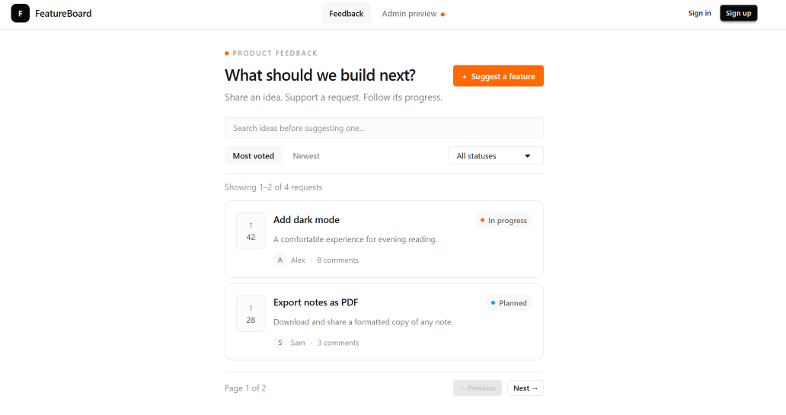
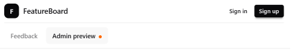

# Part 11 — Add active navigation

Our screens are built. Next, we’ll connect the public feedback page and admin preview through the shared header.

The navigation will highlight the current section. On smaller screens, it will move to a second row.

## Create the navigation component

Create `components/layout/site-navigation.tsx`:

```tsx
"use client";

import Link from "next/link";
import { usePathname } from "next/navigation";

const navigationLinks = [
  {
    href: "/",
    label: "Feedback",
    matches: (pathname: string) =>
      pathname === "/" || pathname.startsWith("/requests/"),
  },
  {
    href: "/admin",
    label: "Admin preview",
    matches: (pathname: string) =>
      pathname === "/admin" || pathname.startsWith("/admin/"),
  },
];

export function SiteNavigation() {
  const pathname = usePathname();

  return (
    <nav
      aria-label="Main navigation"
      className="flex items-center gap-1"
    >
      {navigationLinks.map((link) => {
        const isActive = link.matches(pathname);
        const isCurrentPage = pathname === link.href;

        return (
          <Link
            key={link.href}
            href={link.href}
            aria-current={
              isCurrentPage ? "page" : isActive ? "location" : undefined
            }
            className={`rounded-md px-3 py-2 text-xs font-medium transition-colors focus-visible:outline-2 focus-visible:outline-offset-2 focus-visible:outline-orange-500 ${
              isActive
                ? "bg-base-200 text-base-content"
                : "text-base-content/55 hover:bg-base-200/60 hover:text-base-content"
            }`}
          >
            {link.label}

            {link.href === "/admin" && (
              <span
                aria-hidden="true"
                className="ml-1.5 inline-block size-1.5 rounded-full bg-orange-500"
              />
            )}
          </Link>
        );
      })}
    </nav>
  );
}
```

The navigation uses `usePathname` to read the current URL path, so it needs `"use client"`.

Each link defines which paths belong to its section.

Feedback stays highlighted on the homepage, request details, and submission page. Admin preview stays highlighted on the admin route and any future nested admin routes.

Sign-in and sign-up belong to neither section, so neither link highlights on those pages.

## Identify the active location

We distinguish the exact destination from a page within the same section.

For the exact destination, `aria-current="page"` identifies the current page.

For a nested request route, `aria-current="location"` identifies the active section.

The background and text styles provide the visible highlight.

The focus outline helps keyboard users follow navigation as they press Tab.

## Update the shared header

Replace `components/layout/site-header.tsx`:

```tsx
import Link from "next/link";
import { SiteNavigation } from "./site-navigation";

export function SiteHeader() {
  return (
    <header className="border-b border-base-300">
      <div className="mx-auto flex max-w-6xl flex-wrap items-center justify-between gap-x-4 gap-y-2 px-3 py-2 sm:px-4">
        <Link
          href="/"
          aria-label="FeatureBoard home"
          className="flex shrink-0 items-center gap-2 rounded-md focus-visible:outline-2 focus-visible:outline-offset-2 focus-visible:outline-orange-500"
        >
          <span
            aria-hidden="true"
            className="flex size-7 items-center justify-center rounded-lg bg-neutral text-xs font-bold text-neutral-content"
          >
            F
          </span>

          <span className="text-sm font-semibold">FeatureBoard</span>
        </Link>

        <div className="order-last w-full border-t border-base-300 pt-2 sm:order-none sm:w-auto sm:border-0 sm:pt-0">
          <SiteNavigation />
        </div>

        <nav
          aria-label="Account navigation"
          className="flex shrink-0 items-center gap-1"
        >
          <Link
            href="/sign-in"
            className="btn btn-ghost btn-xs focus-visible:outline-2 focus-visible:outline-offset-2 focus-visible:outline-orange-500"
          >
            Sign in
          </Link>

          <Link
            href="/sign-up"
            className="btn btn-neutral btn-xs focus-visible:outline-2 focus-visible:outline-offset-2 focus-visible:outline-orange-500"
          >
            Sign up
          </Link>
        </nav>
      </div>
    </header>
  );
}
```

The header remains a Server Component. It renders the client navigation component inside its shared layout.

We keep the main and account navigation in separate labeled groups.

On small screens, `order-last` moves the main navigation below the logo and account links. At the `sm` breakpoint, it returns to the same row.

## Keep the preview explicit

The admin link is labeled Admin preview because authentication and authorization aren’t connected yet.

Displaying or hiding a link doesn’t secure a route. In the backend chapter, we’ll verify permissions on the server and show administrative navigation only to authorized users.

## Check the result

Click Feedback and Admin preview. Confirm that the current section highlights.

Open a request from the homepage. Feedback should remain highlighted.

Open Sign in. Neither main navigation link should highlight.

Press Tab to move through the header and confirm that each link has a visible focus indicator.



Resize the browser to a mobile width. The main navigation should move to a second row without horizontal overflow.

<!-- Optional: include the following image if you captured a mobile screenshot. -->



## Save the checkpoint

We’re still working on `feat/app-shell`.

Review the changed files:

```bash
git status --short
```

Stage the header, navigation, and documentation:

```bash
git add components/layout/site-header.tsx components/layout/site-navigation.tsx docs/tutorial
```

Commit and upload:

```bash
git commit -m "feat: add active shared navigation"
git push
```

## Checkpoint

Users can navigate between the feedback interface and admin preview.

The header highlights the current section, supports visible keyboard focus, and adapts to smaller screens.

Next, we’ll build a custom not-found page.