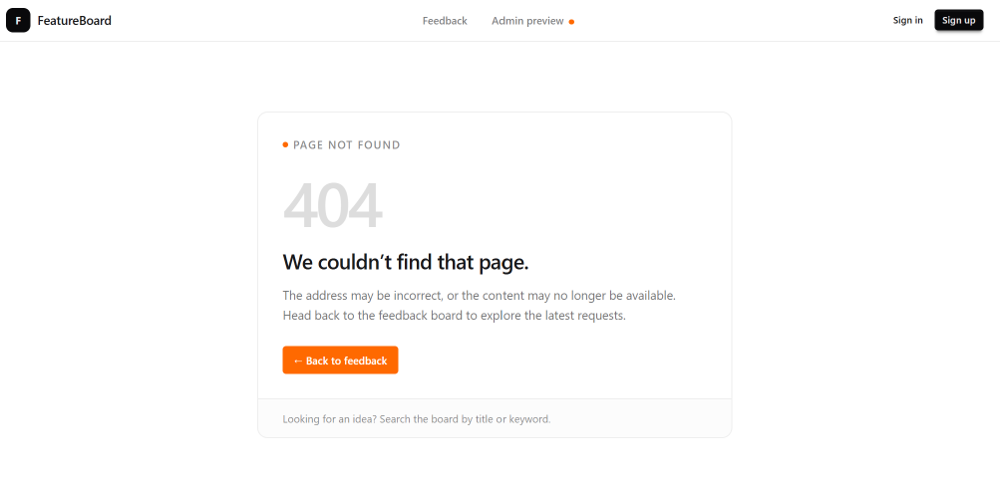

# Part 12 — Build the not-found page

Our application needs a useful response when someone opens an address that doesn’t exist.

We’ll create a not-found page that matches the interface and provides a clear route back to the feedback board.

## Create the page

Create `app/not-found.tsx`:

```tsx
import Link from "next/link";

export default function NotFound() {
  return (
    <main className="mx-auto max-w-xl px-3 py-12 sm:px-4 sm:py-20">
      <div className="overflow-hidden rounded-xl border border-base-300">
        <div className="p-5 sm:p-7">
          <p className="flex items-center gap-1.5 text-[11px] font-semibold uppercase tracking-widest text-base-content/50">
            <span
              aria-hidden="true"
              className="size-1.5 rounded-full bg-orange-500"
            />
            Page not found
          </p>

          <span
            aria-hidden="true"
            className="mt-5 block text-7xl font-semibold tracking-tighter text-base-content/15"
          >
            404
          </span>

          <h1 className="mt-4 text-2xl font-semibold tracking-tight">
            We couldn’t find that page.
          </h1>

          <p className="mt-3 text-sm leading-relaxed text-base-content/60">
            The address may be incorrect, or the content may no longer
            be available. Head back to the feedback board to explore
            the latest requests.
          </p>

          <Link
            href="/"
            className="btn btn-sm mt-6 border-orange-500 bg-orange-500 text-white shadow-none hover:border-orange-600 hover:bg-orange-600 focus-visible:outline-2 focus-visible:outline-offset-2 focus-visible:outline-orange-500"
          >
            ← Back to feedback
          </Link>
        </div>

        <div className="border-t border-base-300 bg-base-200/30 px-5 py-3 sm:px-7">
          <p className="text-xs leading-relaxed text-base-content/50">
            Looking for an idea? Search the board by title or keyword.
          </p>
        </div>
      </div>
    </main>
  );
}
```

The filename `not-found.tsx` is a Next.js routing convention.

Our root-level not-found component provides the interface for unmatched URLs and for the existing request route’s `notFound()` call.

The root layout continues to supply the shared header.

## Connect missing requests

The request details route already checks whether a matching request exists:

```tsx
if (!request) {
  notFound();
}
```

We don’t need to change that code.

When the lookup fails, Next.js stops rendering the request content and displays the not-found interface.

## Provide a useful recovery action

The message explains that the address may be incorrect or the content unavailable.

The Back to feedback link gives the user a reliable destination. It works even when they opened the invalid address directly.

The large 404 is decorative and hidden from assistive technology. The heading communicates the error in plain language.

## Check the result

Open `/requests/999`.

Confirm that the custom not-found interface appears instead of a request.

Next, open `/this-page-does-not-exist` to check an unmatched URL.

Click Back to feedback and confirm that the homepage loads.

Resize the browser to check the mobile layout. Use Tab to confirm that the return link has a visible focus indicator.



## Save the checkpoint

We’re still working on `feat/app-shell`.

Review the changed files:

```bash
git status --short
```

Stage the page and documentation:

```bash
git add app/not-found.tsx docs/tutorial
```

Commit and upload:

```bash
git commit -m "feat: add custom not-found page"
git push
```

## Checkpoint

Unknown URLs and missing requests display a consistent recovery page.

Next, we’ll improve admin card movement for touch and keyboard users.