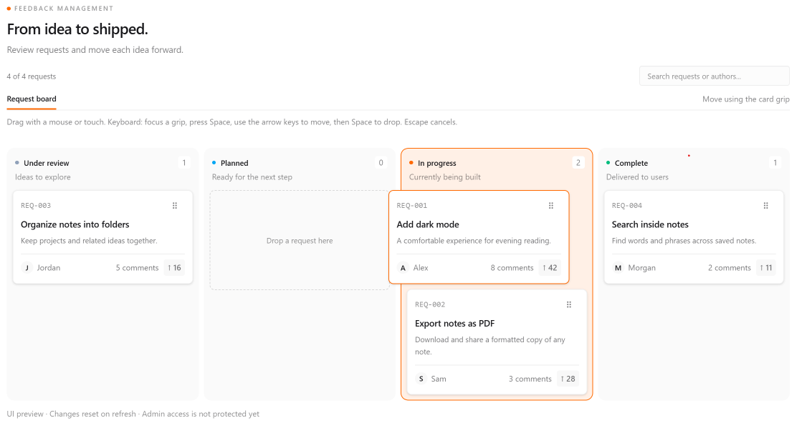

# Part 13 — Add touch and keyboard dragging

Our admin board supports desktop dragging. Next, we’ll extend card movement to touch and keyboard input.

We’ll replace native browser dragging with dnd-kit while keeping the same cards, columns, and status-based organization.

We’re using the established `@dnd-kit/core` API. Its documentation labels this API Legacy; this implementation consistently uses that package.

Reference: https://dndkit.com/legacy/introduction/getting-started/

## Install the dependency

Run:

```bash
npm install @dnd-kit/core
```

The package provides the drag context, draggable elements, drop zones, and input sensors.

## Update the request card

Replace `features/requests/components/admin-request-card.tsx`:

```tsx
"use client";

import Link from "next/link";
import { useDraggable } from "@dnd-kit/core";
import type { FeatureRequest } from "../types";

type AdminRequestCardProps = {
  request: FeatureRequest;
};

export function AdminRequestCard({
  request,
}: AdminRequestCardProps) {
  const {
    attributes,
    listeners,
    setNodeRef,
    setActivatorNodeRef,
    transform,
    isDragging,
  } = useDraggable({
    id: request.id,
  });

  return (
    <article
      ref={setNodeRef}
      style={{
        transform: transform
          ? `translate3d(${transform.x}px, ${transform.y}px, 0)`
          : undefined,
        position: "relative",
        zIndex: isDragging ? 20 : undefined,
      }}
      className={`min-w-0 rounded-lg border bg-base-100 p-3 shadow-sm ${
        isDragging
          ? "border-orange-500 shadow-lg"
          : "border-base-300"
      }`}
    >
      <div className="flex items-center justify-between gap-2">
        <span className="font-mono text-[11px] text-base-content/45">
          REQ-{request.id.padStart(3, "0")}
        </span>

        <button
          ref={setActivatorNodeRef}
          type="button"
          {...attributes}
          {...listeners}
          aria-label={`Move ${request.title}`}
          title="Drag to move. With keyboard: Space, arrows, Space."
          className="-my-1 flex size-8 touch-none cursor-grab items-center justify-center rounded text-base-content/55 hover:bg-base-200 focus-visible:outline-2 focus-visible:outline-offset-2 focus-visible:outline-orange-500 active:cursor-grabbing"
        >
          <span aria-hidden="true">⠿</span>
        </button>
      </div>

      <h3 className="mt-2 break-words text-sm font-semibold leading-snug">
        <Link
          href={`/requests/${request.id}`}
          draggable={false}
          className="rounded hover:underline focus-visible:outline-2 focus-visible:outline-offset-2 focus-visible:outline-orange-500"
        >
          {request.title}
        </Link>
      </h3>

      <p className="mt-1.5 line-clamp-2 break-words text-xs leading-relaxed text-base-content/60">
        {request.description}
      </p>

      <div className="mt-3 flex flex-wrap items-center justify-between gap-2 border-t border-base-300 pt-2">
        <span className="flex min-w-0 items-center gap-1.5">
          <span
            aria-hidden="true"
            className="flex size-5 shrink-0 items-center justify-center rounded-full bg-base-200 text-[10px] font-medium"
          >
            {request.author.name.charAt(0)}
          </span>

          <span className="truncate text-[11px] text-base-content/60">
            {request.author.name}
          </span>
        </span>

        <div className="flex items-center gap-2 text-[11px] text-base-content/60">
          <Link
            href={`/requests/${request.id}#comments`}
            className="rounded hover:underline focus-visible:outline-2 focus-visible:outline-offset-2 focus-visible:outline-orange-500"
          >
            {request.comments} comments
          </Link>

          <span className="rounded bg-base-200 px-1.5 py-1 font-medium">
            ↑ {request.votes}
          </span>
        </div>
      </div>
    </article>
  );
}
```

`useDraggable` registers the card using its request ID.

The card receives the draggable node reference. The grip receives the activator reference, attributes, and listeners.

The grip is now a real button, so keyboard users can focus it.

The transform moves the card visually during a drag. It doesn’t change the request’s status until the user drops it.

The `touch-none` class applies only to the grip. Dragging from the grip moves the card, while touching elsewhere allows normal page scrolling.

## Update the drop zones

Replace `features/requests/components/admin-board-column.tsx`:

```tsx
"use client";

import { useDroppable } from "@dnd-kit/core";
import type { ReactNode } from "react";
import type { RequestStatus } from "../types";
import { requestStatuses } from "../statuses";

type AdminBoardColumnProps = {
  status: RequestStatus;
  count: number;
  isSearching: boolean;
  children: ReactNode;
};

const descriptions: Record<RequestStatus, string> = {
  UNDER_REVIEW: "Ideas to explore",
  PLANNED: "Ready for the next step",
  IN_PROGRESS: "Currently being built",
  COMPLETE: "Delivered to users",
};

export function AdminBoardColumn({
  status,
  count,
  isSearching,
  children,
}: AdminBoardColumnProps) {
  const { setNodeRef, isOver } = useDroppable({
    id: status,
  });

  const configuration = requestStatuses[status];

  return (
    <section
      ref={setNodeRef}
      aria-label={`${configuration.label} requests`}
      className={`min-w-0 rounded-xl border p-2 ${
        isOver
          ? "border-orange-500 bg-orange-500/10"
          : "border-transparent bg-base-200/70"
      }`}
    >
      <div className="px-1 pb-3 pt-1">
        <div className="flex items-center justify-between gap-2">
          <h2 className="flex items-center gap-2 text-xs font-semibold">
            <span
              aria-hidden="true"
              className={`size-1.5 rounded-full ${configuration.dotClass}`}
            />
            {configuration.label}
          </h2>

          <span className="flex size-5 items-center justify-center rounded bg-base-100 text-[11px] text-base-content/55">
            {count}
          </span>
        </div>

        <p className="mt-1 text-[11px] text-base-content/50">
          {descriptions[status]}
        </p>
      </div>

      <div className="min-h-40 space-y-2">
        {children}

        {count === 0 && (
          <div
            className={`flex min-h-40 items-center justify-center rounded-lg border border-dashed px-2 text-center text-xs ${
              isOver
                ? "border-orange-500 text-orange-600"
                : "border-base-content/15 text-base-content/50"
            }`}
          >
            {isOver
              ? "Drop request here"
              : isSearching
                ? "No matching requests"
                : "Drop a request here"}
          </div>
        )}
      </div>
    </section>
  );
}
```

Each column registers as a drop zone using its status identifier.

The `isOver` value controls its highlight. We no longer need native drag-over and drag-leave handlers.

An empty column retains enough height to receive a card.

## Update the board

Replace `features/requests/components/admin-request-board.tsx`:

```tsx
"use client";

import { useState } from "react";
import {
  DndContext,
  KeyboardSensor,
  PointerSensor,
  rectIntersection,
  useSensor,
  useSensors,
  type DragEndEvent,
} from "@dnd-kit/core";

import type { FeatureRequest, RequestStatus } from "../types";
import { requestStatuses } from "../statuses";
import { AdminBoardColumn } from "./admin-board-column";
import { AdminRequestCard } from "./admin-request-card";

type AdminRequestBoardProps = {
  initialRequests: FeatureRequest[];
};

const statuses = Object.keys(requestStatuses) as RequestStatus[];

function isRequestStatus(value: string): value is RequestStatus {
  return Object.prototype.hasOwnProperty.call(requestStatuses, value);
}

export function AdminRequestBoard({
  initialRequests,
}: AdminRequestBoardProps) {
  const [requests, setRequests] = useState(initialRequests);
  const [search, setSearch] = useState("");
  const [notice, setNotice] = useState("");

  const sensors = useSensors(
    useSensor(PointerSensor, {
      activationConstraint: {
        distance: 6,
      },
    }),
    useSensor(KeyboardSensor, {
      scrollBehavior: "auto",
    }),
  );

  function finishDrag({ active, over }: DragEndEvent) {
    if (!over) {
      setNotice("Move cancelled. The request stayed in its original column.");
      return;
    }

    const id = String(active.id);
    const destination = String(over.id);

    if (!isRequestStatus(destination)) return;

    const request = requests.find((item) => item.id === id);

    if (!request || request.status === destination) return;

    setRequests((current) =>
      current.map((item) =>
        item.id === id ? { ...item, status: destination } : item,
      ),
    );

    setNotice(
      `${request.title} moved to ${requestStatuses[destination].label.toLowerCase()}.`,
    );
  }

  const query = search.trim().toLowerCase();

  const visibleRequests = requests.filter((request) =>
    `${request.title} ${request.description} ${request.author.name}`
      .toLowerCase()
      .includes(query),
  );

  return (
    <div className="mt-4">
      <div className="flex flex-col justify-between gap-3 sm:flex-row sm:items-center">
        <p className="text-xs text-base-content/60">
          {visibleRequests.length} of {requests.length} requests
        </p>

        <input
          type="search"
          aria-label="Search admin requests"
          value={search}
          onChange={(event) => setSearch(event.target.value)}
          placeholder="Search requests or authors..."
          className="input input-sm w-full border-base-300 bg-base-200/40 text-xs sm:w-60"
        />
      </div>

      <div className="mt-3 flex flex-wrap items-center justify-between gap-2 border-b border-base-300">
        <span className="border-b-2 border-orange-500 pb-2 text-xs font-medium">
          Request board
        </span>

        <span className="pb-2 text-[11px] text-base-content/55">
          Move using the card grip
        </span>
      </div>

      <p className="mt-2 text-[11px] leading-relaxed text-base-content/55">
        Drag with a mouse or touch. Keyboard: focus a grip, press Space,
        use the arrow keys to move, then Space to drop. Escape cancels.
      </p>

      <p
        role="status"
        aria-live="polite"
        aria-atomic="true"
        className="mt-2 min-h-4 text-xs text-base-content/60"
      >
        {notice}
      </p>

      <DndContext
        id="admin-request-board"
        sensors={sensors}
        collisionDetection={rectIntersection}
        onDragStart={() => setNotice("")}
        onDragEnd={finishDrag}
        onDragCancel={() => setNotice("Move cancelled.")}
        accessibility={{
          screenReaderInstructions: {
            draggable:
              "To pick up a request, press Space. Use the arrow keys to move it into another status column. Press Space to drop, or Escape to cancel.",
          },
        }}
      >
        <div className="mt-2 grid items-stretch gap-2 sm:grid-cols-2 lg:grid-cols-4">
          {statuses.map((status) => {
            const items = visibleRequests
              .filter((request) => request.status === status)
              .sort(
                (a, b) =>
                  b.votes - a.votes || a.id.localeCompare(b.id),
              );

            return (
              <AdminBoardColumn
                key={status}
                status={status}
                count={items.length}
                isSearching={query.length > 0}
              >
                {items.map((request) => (
                  <AdminRequestCard
                    key={request.id}
                    request={request}
                  />
                ))}
              </AdminBoardColumn>
            );
          })}
        </div>
      </DndContext>

      <p className="mt-3 text-[11px] text-base-content/50">
        UI preview · Changes reset on refresh · Admin access is not
        protected yet
      </p>
    </div>
  );
}
```

The admin route doesn’t need changes.

## Understand the sensors

`DndContext` connects the cards and columns.

The pointer sensor handles mouse, touch, and pen input. Its six-pixel activation distance helps distinguish a drag from a small accidental movement.

The keyboard sensor lets users pick up a focused card grip with Space, move with arrow keys, and drop with Space. Escape cancels.

The default keyboard movement uses small increments, so reaching another column may require several arrow presses.

## Update status on drop

The collision detector compares the dragged card’s rectangle with the column rectangles.

When the drag ends, `active` identifies the card and `over` identifies the destination column.

We check that the destination is a valid request status before updating state.

If no column is selected, the status remains unchanged. Dropping into the existing column also makes no change.

Requests remain sorted by votes within each status. We aren’t implementing manual ordering within a column.

The library provides screen-reader drag instructions and announcements. Our status message also confirms completed moves.

These features support accessible interaction, but keyboard focus and screen-reader behavior should still be checked across the browsers and devices we intend to support.

## Check pointer movement

Open `/admin`.

Drag a card by its grip using a mouse. Confirm that the destination highlights and the card moves after release.

On a touch device, drag from the grip. Swipe elsewhere on the card to check that normal page scrolling still works.

Dropping without overlapping any column should leave the request in its original status.

## Check keyboard movement

Press Tab until a card grip receives focus.

Press Space to pick up the card.

Use the arrow keys to move it over another column, then press Space to drop it.

Check that the request changes status and the column counts update.

Start another move and press Escape. Confirm that the request stays in its original column.

<!-- Save a screenshot showing keyboard focus or a highlighted destination
as images/13-keyboard-drag.png. -->



## Save the checkpoint

We’re still working on `feat/app-shell`.

Review the changed files:

```bash
git status --short
```

Stage the components, dependency files, and documentation:

```bash
git add features/requests/components package.json package-lock.json docs/tutorial
```

Commit and upload:

```bash
git commit -m "feat: support pointer and keyboard board dragging"
git push
```

## Checkpoint

The admin board supports pointer and keyboard dragging while keeping status changes on the card grip.

The interface still uses local sample data. Changes reset on refresh, and admin access isn’t protected yet.

Next, we’ll run the final UI checks and production build before merging the branch.