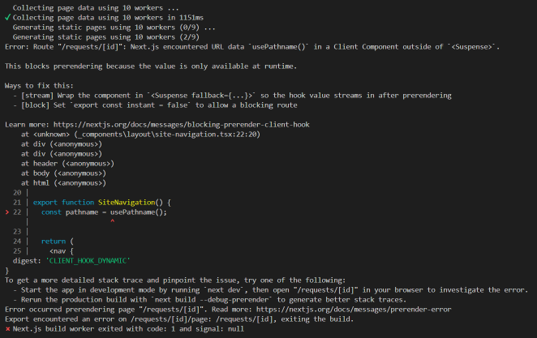
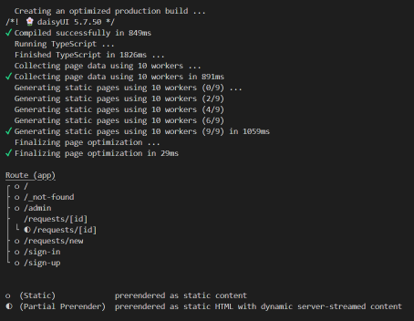

# Part 14 — Verify and save the finished UI

Our interface is complete for this chapter.

Before merging the feature branch, we’ll check the production build, run ESLint, and test the application in production mode.

## Run the production build

From the project terminal, run:

```bash
npm run build
```

This compiles the application and checks whether Next.js can prepare its routes for production.

Our first build found an issue in the shared navigation.

## Understand the navigation error

The navigation uses `usePathname` to highlight the current section.

During the build, Next.js reported that this hook was reading runtime URL data outside a Suspense boundary.



We already added a Suspense boundary around the request details content. That boundary couldn’t cover the navigation because the shared header sits above the page in the root layout.

A Suspense boundary must be above the component that performs the runtime read.

Reference: https://nextjs.org/docs/messages/blocking-prerender-client-hook

## Add a navigation boundary

Open the existing header file.

In this project, its location is `_components/layout/site-header.tsx`. If you used `components/layout` in the earlier sections, update the header there instead.

Keep the existing import path in `app/layout.tsx` pointing to your header.

Replace the header file with:

```tsx
import Link from "next/link";
import { Suspense } from "react";
import { SiteNavigation } from "./site-navigation";

export function SiteHeader() {
  return (
    <header className="border-b border-base-300">
      <div className="mx-auto flex max-w-6xl flex-wrap items-center justify-between gap-x-4 gap-y-2 px-3 py-2 sm:px-4">
        <Link
          href="/"
          aria-label="FeatureBoard home"
          className="flex shrink-0 items-center gap-2 rounded-md focus-visible:outline-2 focus-visible:outline-offset-2 focus-visible:outline-orange-500"
        >
          <span
            aria-hidden="true"
            className="flex size-7 items-center justify-center rounded-lg bg-neutral text-xs font-bold text-neutral-content"
          >
            F
          </span>

          <span className="text-sm font-semibold">FeatureBoard</span>
        </Link>

        <div className="order-last w-full border-t border-base-300 pt-2 sm:order-none sm:w-auto sm:border-0 sm:pt-0">
          <Suspense fallback={<NavigationFallback />}>
            <SiteNavigation />
          </Suspense>
        </div>

        <nav
          aria-label="Account navigation"
          className="flex shrink-0 items-center gap-1"
        >
          <Link
            href="/sign-in"
            className="btn btn-ghost btn-xs focus-visible:outline-2 focus-visible:outline-offset-2 focus-visible:outline-orange-500"
          >
            Sign in
          </Link>

          <Link
            href="/sign-up"
            className="btn btn-neutral btn-xs focus-visible:outline-2 focus-visible:outline-offset-2 focus-visible:outline-orange-500"
          >
            Sign up
          </Link>
        </nav>
      </div>
    </header>
  );
}

function NavigationFallback() {
  return (
    <nav
      aria-label="Main navigation"
      className="flex items-center gap-1"
    >
      <Link
        href="/"
        className="rounded-md px-3 py-2 text-xs font-medium text-base-content/55 hover:bg-base-200/60 hover:text-base-content focus-visible:outline-2 focus-visible:outline-offset-2 focus-visible:outline-orange-500"
      >
        Feedback
      </Link>

      <Link
        href="/admin"
        className="rounded-md px-3 py-2 text-xs font-medium text-base-content/55 hover:bg-base-200/60 hover:text-base-content focus-visible:outline-2 focus-visible:outline-offset-2 focus-visible:outline-orange-500"
      >
        Admin preview
        <span
          aria-hidden="true"
          className="ml-1.5 inline-block size-1.5 rounded-full bg-orange-500"
        />
      </Link>
    </nav>
  );
}
```

The fallback provides usable navigation without reading the pathname.

When the pathname becomes available, the active navigation replaces it.

The header remains a Server Component, while `SiteNavigation` remains a Client Component.

## Rebuild the application

Run:

```bash
npm run build
```

The build should now complete successfully.



The build output identifies static routes with a circle.

The request details route uses partial prerendering. Next.js prepares its static shell and streams the runtime-dependent content through our Suspense boundary.

## Run ESLint

Run:

```bash
npx eslint .
```

Resolve any reported errors before continuing.

A successful production build and lint check provide different forms of verification. We’ll also test the interface directly.

## Test production mode

Stop the development server with Ctrl + C.

Start the production server:

```bash
npm run start
```

Open http://localhost:3000.

Check the following:

| Route | What to verify |
|---|---|
| `/` | Search, status filters, sorting, pagination, and empty results |
| `/requests/1` | Full description, status, author, date, and back link |
| `/requests/new` | Required fields, character counts, and preview feedback |
| `/sign-up` | Name field, email validation, and password visibility |
| `/sign-in` | Correct fields and navigation |
| `/admin` | Search, pointer dragging, keyboard movement, and cancellation |
| `/requests/999` | Custom not-found interface |
| `/this-page-does-not-exist` | Custom not-found interface |

For pagination testing with four sample requests, temporarily use a page size of two in development. Restore the final value of four before building the release.

Check narrow screen layouts for horizontal overflow.

Use Tab to check focus visibility and navigation.

The form messages should clearly describe preview behavior. They must not claim that an account or request was saved.

## Save the final UI checkpoint

Confirm the current branch:

```bash
git branch --show-current
```

It should display `feat/app-shell`.

Review the changed files:

```bash
git status --short
```

Stage the header fix, completed documentation, and any remaining UI changes:

```bash
git add .
```

Commit and upload:

```bash
git commit -m "fix: add navigation Suspense boundary and verify UI"
git push
```

## Merge the UI branch

Switch to the main branch:

```bash
git switch main
```

Bring it up to date:

```bash
git pull --ff-only origin main
```

Merge the completed feature branch:

```bash
git merge --no-ff feat/app-shell -m "Merge completed UI build"
```

The `--no-ff` option preserves a merge commit marking the completed UI chapter.

Upload the updated main branch:

```bash
git push origin main
```

## Tag the UI release

Create an annotated tag:

```bash
git tag -a ui-v1 -m "Completed FeatureBoard UI tutorial"
```

Upload the tag:

```bash
git push origin ui-v1
```

The tag marks the exact code used at the end of this tutorial.

On GitHub, select `main` to see the merged application. Select `ui-v1` from the tags menu to return to this checkpoint later.

## Completed UI

We now have:

- A shared header with active navigation.
- Reusable request cards and status badges.
- Search, status filtering, sorting, and pagination.
- A dynamic request details page.
- A feature submission form preview.
- Shared sign-in and sign-up screens.
- An admin board with pointer and keyboard dragging.
- A custom not-found page.
- A verified production build.
- Markdown documentation and screenshots.
- A tagged GitHub checkpoint.

The application still uses sample data and local state.

It doesn’t create accounts, establish sessions, save requests, or enforce admin permissions yet.

The next chapter will introduce PostgreSQL, Prisma, and authentication.